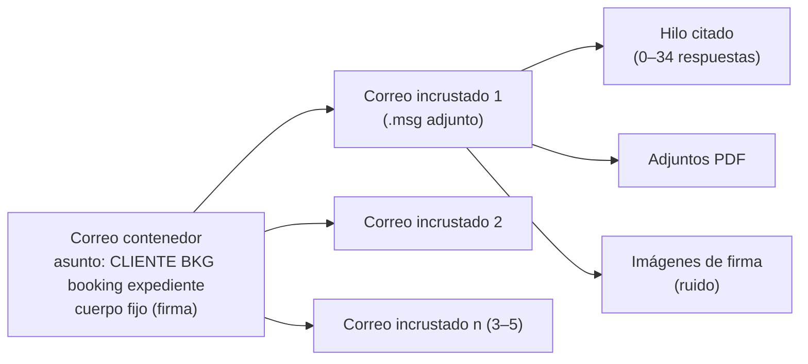
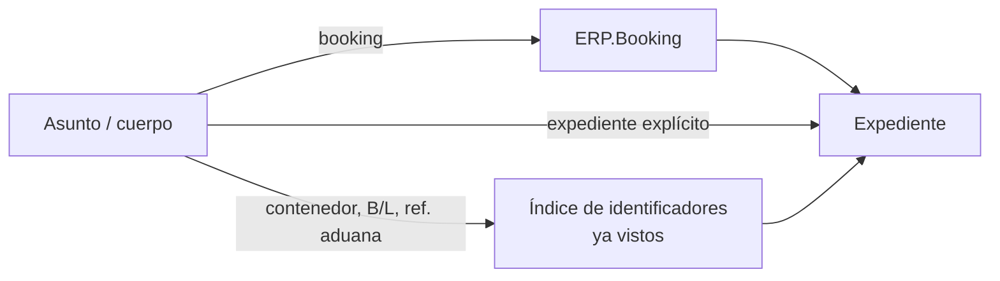

# Análisis de los datos de la muestra

| Campo | Valor |
|---|---|
| Versión | 0.2.0 |
| Estado | Borrador |
| Responsable | Pablo Iglesias Peral |
| Última actualización | 22/11/2026 |
| Tareas | F1.1 (#8), F1.2 (#9), F1.3 (#10) |

> **Confidencialidad:** este documento describe **patrones y cifras agregadas**. No contiene nombres de clientes, personas, números de expediente, bookings, B/L, contenedores ni buques. Los ejemplos de formato son sintéticos. El inventario detallado está solo en local (`data/output/`, ignorado por git).

## 1. Resumen

- La muestra son **11 expedientes de exportación marítima FCL** (contenedor completo), cada uno con su correo y su fila en el ERP.
- Cada `.msg` es un **contenedor**: un correo que el personal de operaciones se envía a sí mismo con los correos relevantes del expediente **incrustados como adjuntos** (38 en total, entre 3 y 5 por expediente).
- Los correos incrustados son **largos y con hilos profundos** (mediana de 17.000 caracteres y hasta 34 respuestas citadas). Hay que dividirlos en mensajes antes de extraer.
- **El booking es la clave de asociación**: aparece en el asunto de 37 de 38 correos, frente a 7 de 38 del número de expediente. El ERP tiene el booking en una columna propia.
- El ERP **no guarda** contenedores, viaje, cut-offs ni B/L, y sus fechas **no distinguen** entre estimada y real salvo por dos indicadores. Esos datos solo existen en los correos.
- En la muestra ya se ven **errores del ERP** que el sistema debe detectar (§4.4).

## 2. Correos (F1.1)

### 2.1 Estructura del fichero

| Elemento | Observación |
|---|---|
| Correo contenedor | Remitente = destinatario (interno), todos creados en una misma sesión. Asunto con el patrón `<CLIENTE> BKG <booking> <expediente>`. Cuerpo idéntico en los 11 (solo firma). **No es un correo operativo**: es la forma de preparar la muestra |
| Correos incrustados | 38 `.msg` adjuntos. Todos con cuerpo HTML y su versión en texto |
| Tamaño del cuerpo | Mínimo ≈ 1.100 caracteres, mediana ≈ 17.000, percentil 90 ≈ 77.000 y máximo ≈ 133.000 |
| Hilos | Mediana de 6 respuestas citadas; 14 de 38 correos tienen 10 o más. La información más reciente está arriba, pero la historia completa del expediente está en la cita |
| Imágenes incrustadas | ≈ 380, casi todas logotipos y firmas. Se descartan |
| Remitentes | 17 de 38 son internos (reenvíos y respuestas del equipo); el resto vienen de 9 dominios externos |
| Idioma | Español e inglés, a menudo mezclados en el mismo hilo |

**Implicación para la ingesta (F3.2):** en producción llegarán los correos operativos directamente, no los contenedores. La PoC debe **desempaquetar** el contenedor y procesar cada correo incrustado como si hubiera llegado por separado, y dividir cada hilo en mensajes (cabeceras `De:`/`From:` citadas) para fechar cada dato por el mensaje que lo aporta.

### 2.2 Tipos de correo observados

| Tipo | Emisor típico | Asunto | Contenido útil |
|---|---|---|---|
| Orden o reserva de transporte terrestre | Transportista de acarreo | Muy estructurado: `ORDEN DE TRANSPORTE <lugar> <dd/mm/aaaa> - <n>x<tipo> - Booking: <bkg> - <exp>` | Fecha y lugar de carga, número y tipo de contenedores, matrícula del contenedor asignado |
| Levante (aduana) | Interno | `LEVANTE <bkg>` o `<bkg> LEVANTE` | 1–2 PDF: documento de levante y relación de medio de transporte |
| Solicitud de despacho | Agente de aduanas | `Solicitud Despacho Operación <ref> - Partida: <n>` | DUA de exportación y levante en PDF |
| Booking, enmienda y confirmación | Naviera | `BOOKING AMENDMENT <bkg>`, `AVISO BOOKING …` | Buque, viaje, puertos, ETD, cut-offs |
| Instrucciones de embarque y B/L | Naviera o cliente | `SHIPPING INSTRUCTION …`, `BL DRAFT …` | Asunto tipo EDI con clave=valor (`BKG=`, `VOY=`, `POL=`, `POD=`); número de B/L, contenedores, pesos |
| Hilo comercial u operativo con el cliente | Cliente o interno | Libre, con el booking al final | Cambios de fecha, incidencias, roleos, instrucciones |
| Inspección previa al embarque | Agencia de inspección | Libre | Certificado en PDF |

La taxonomía formal se cierra en F1.5 (#12).

### 2.3 Identificadores

| Identificador | Formato observado | Dónde aparece |
|---|---|---|
| Expediente | `ES` + 8 dígitos | Asunto del contenedor; solo 7 de 38 asuntos incrustados. **Hay un caso truncado** (`Exp. ES` + 4 dígitos) |
| Booking | Tres formatos según la naviera: numérico de 8–9 dígitos, o prefijo de 3–4 letras + 7–8 dígitos | 37 de 38 asuntos |
| Contenedor | 4 letras + 7 dígitos (ISO 6346, con dígito de control) | Cuerpos y PDF |
| B/L | Prefijo de la naviera + alfanumérico | Hilos de B/L y PDF |
| Referencias de aduana | Referencia de operación del agente, número de DUA | Asunto y PDF de despacho |
| Referencia del cliente | Número de pedido u orden libre | Asunto (a veces) y columna `Ref. Cliente` del ERP |

Los números de booking numéricos se confunden con otras cifras largas (pedidos, teléfonos); el extractor debe exigir contexto (`BKG`, `Booking:`, posición en el asunto) o validar contra el ERP.

### 2.4 Adjuntos PDF

23 PDF en total (entre 9 y 770 KB), en 14 de los 38 correos.

| Tipo de documento | Frecuencia | Capa de texto |
|---|---|---|
| Documento de levante en aduana de exportación | Alta (en casi todos los expedientes) | Sí; plantilla oficial idéntica |
| Declaración de exportación (DUA) | Media | Sí; plantilla oficial |
| Relación de medio de transporte | Media | Sí |
| Autorización de salida en aduana | Baja | Sí |
| Borrador de B/L y confirmación de booking de la naviera | Baja | Sí; formato propio de cada naviera |
| Certificado de inspección | Baja | Sí |
| Documentos escaneados | 3 de 23 (≈ 13 %) | **No: requieren OCR** |

**Implicación (§7.1 del plan):** los documentos de aduana siguen plantillas oficiales fijas, así que se extraen con **reglas por plantilla**, sin LLM. El OCR solo hace falta en una minoría.

## 3. ERP (F1.2)

### 3.1 Formato

- CSV en UTF-8 **con BOM**, separador `;`, coma decimal (`22,890`) y fechas `dd/mm/aaaa` sin hora ni zona horaria.
- 11 filas (una por expediente) y 88 columnas, de las que **19 están siempre vacías** en la muestra.
- Hay valores con **espacios al principio o al final** (por ejemplo, en el booking y en el transportista). Sin normalizar, el cruce falla.

### 3.2 Columnas relevantes para el cruce

| Concepto | Columna(s) del ERP | Observación |
|---|---|---|
| Expediente | `Operación` | Clave primaria |
| Booking | `Booking` | Siempre informado. **Clave de asociación con los correos** |
| B/L | `Master` | Solo en 2 de 11, y en ambos igual al booking: no es fiable como B/L |
| Salida (ETD/ATD) | `Salida`, `Fecha Dep.` | Duplicadas (iguales en 11 de 11). Sin distinguir estimada o real |
| Llegada (ETA/ATA) | `Llegada` | 1 vacía |
| ¿Fecha confirmada? | `SalidaOK`, `LlegadaOK` | Indicadores `SI`/`NO`. Hipótesis: `SI` = fecha real confirmada. **Pregunta para EShipping** |
| Carga del contenedor | `F. Carga`, `Lugar Recogida` | Contrastable con la orden de transporte |
| Despacho de aduana | `Despacho` | 6 de 11; entre 0 y 9 días antes de la salida |
| Puertos | `Origen`, `Destino`, `Locode Origen`, `Locode Destino` | Nombre y UN/LOCODE, ambos completos |
| Buque | `Buque` | Siempre informado; **sin número de viaje** |
| Naviera | `Línea Transporte`, `Proveedor Expediente` | |
| Equipo | `Cont`, `TEUS`, `Vol.(m3)` | Número de contenedores y TEU, **sin tipo ni matrícula** |
| Carga | `Peso (TN)`, `Peso Total (Kg)`, `Núm. Bultos`, `Tipo Producto` | `Tipo Producto` mezcla mercancía e incidencias (p. ej., «roleado por naviera») |
| Estado de documentos | `SWB / OBL Evento`, `TRANSPORTE Evento` | `Completado` / `Pendiente` |
| Partes | `Cliente Op.`, `Shipper`, `Consignee`, `Agente Aduana` | |

### 3.3 Lo que el ERP no tiene

Número de contenedor, número de viaje, cut-offs (documental, VGM y de carga), número de B/L fiable, transbordos y distinción entre fecha estimada y real (salvo los indicadores). **Todo eso está solo en los correos**: el sistema no solo detecta discrepancias, también **completa el expediente**.

## 4. Cruce correo ↔ ERP

### 4.1 Asociación

Los 11 contenedores casan con su fila del ERP por expediente y por booking (una vez quitados los espacios). En los correos incrustados el expediente casi nunca aparece, así que la cadena es:

Un correo sin ningún identificador (o con varios de expedientes distintos) va a revisión.

### 4.2 Calidad del dato en el ERP

| Hallazgo | Casos | Tratamiento |
|---|---|---|
| Espacios sobrantes en valores clave | Varios | Normalizar al leer |
| Columnas duplicadas (`Salida` = `Fecha Dep.`) | 11/11 | Usar una y vigilar la otra |
| Fecha de carga anterior a la fecha de alta del expediente | 1 | Posible errata (§4.4) |
| Contenedores, TEU y volumen incoherentes entre sí, peso por encima de la carga máxima de un contenedor | 1 | Regla de coherencia → aviso |
| `Master` igual al booking | 2/2 | No usar como B/L |

### 4.3 Ambigüedades detectadas (se desarrollan en F1.4, #11)

- **Fechas sin estado**: el ERP no dice si una fecha es estimada o real; los correos usan ETD, ETA, «salida prevista», «zarpó», etc.
- **Varias fechas de «carga»**: carga del contenedor en el almacén (acarreo) frente a carga a bordo.
- **Hilos con valores sucesivos** del mismo dato (cambios de buque o de fecha, roleos): vale el último **confirmado**, no el último mencionado.
- **Identificadores truncados o con formato distinto** (expediente acortado, booking con prefijos).
- **Partidas múltiples** y varios contenedores por expediente.

### 4.4 Primeras discrepancias reales

- **Fecha de carga**: en un expediente, la del ERP es anterior a su fecha de alta, mientras que la orden de transporte del correo indica la misma fecha **un mes después**. Es casi seguro una errata en el mes del ERP: un caso de discrepancia que el sistema debe proponer corregir.
- **Coherencia del equipo**: un expediente con un contenedor, dos TEU, 80 m³ y casi 50 t; el correo indicará el número y tipo reales de contenedores.

El inventario exhaustivo de discrepancias es parte del gold standard (F1.3, #10).

## 5. Implicaciones para el diseño

1. **Desempaquetar y dividir**: la unidad de proceso es el *mensaje* (dentro de un hilo), no el fichero.
2. **Asociación determinista por booking** primero; el LLM no hace falta para asociar en la gran mayoría de los casos.
3. **Plantillas para los PDF de aduana** y para los asuntos estructurados (órdenes de transporte, asuntos EDI de la naviera).
4. **LLM solo para el texto libre** de los hilos (cambios de fecha, incidencias), con la evidencia citada.
5. **Normalización obligatoria** antes de cruzar (espacios, formatos de fecha y número, UN/LOCODE).
6. **Cada dato con su estado** (estimado / confirmado), su fuente y su fecha de conocimiento, para resolver los hilos con valores sucesivos.
7. **El sistema enriquece el ERP**, no solo lo contrasta.

## 6. Gold standard (F1.3)

Referencia contra la que se evalúa la PoC (F4.2). Contiene datos reales, así que **solo existe en local** (`data/gold/`, ignorado por git); aquí se describen su formato y sus cifras agregadas.

### 6.1 Contenido

| Nivel | Qué se etiqueta | Para medir |
|---|---|---|
| Correo (38) | Expediente al que pertenece y clases de la taxonomía (multietiqueta, con una clase principal) | Asociación y clasificación |
| Expediente (11) | Valor correcto de cada campo clave, con el correo que lo respalda, su clasificador (`PLN`/`EST`/`ACT`), su `known_at` y el **veredicto** frente al ERP | Extracción por campo y detección de discrepancias |

Campos: booking, buque, salida del buque, llegada a destino, carga en almacén (fecha, hora y lugar), levante de aduana, cut-off, equipo (número, tipo, contenedores y precintos), B/L e incidencias.

### 6.2 Veredictos

| Veredicto | Significado | Qué debe hacer el sistema |
|---|---|---|
| `MATCH` | Correo y ERP coinciden | Nada |
| `ERP_MISSING` | El dato está en los correos y el ERP lo tiene vacío | Proponer completarlo |
| `ERP_ERROR` | El ERP contradice a los correos y el error es claro | Proponer corregirlo (alta prioridad) |
| `ERP_NEWER` | Difieren, pero el ERP refleja probablemente información posterior al último correo | No alertar si el ERP es más reciente (requiere saber cuándo se actualizó) |
| `DISCREPANCY` | Difieren sin poder atribuirlo | Alertar y pedir revisión |
| `MAIL_MISSING` | El ERP tiene el dato y los correos no | Nada (no hay evidencia) |
| `NOT_IN_ERP` | El ERP no tiene columna para el dato | Guardarlo en el expediente enriquecido |

### 6.3 Cifras agregadas

- 38 correos con una media de 1,7 clases. Clase principal: reserva 11, aduanas 11, transporte terrestre 10, documentación 5 e inspección 1.
- 89 comparaciones de campo: 50 `MATCH`, 12 `NOT_IN_ERP`, 8 `ERP_NEWER`, 7 `DISCREPANCY`, 5 `ERP_MISSING`, 4 `ERP_ERROR` y 3 `MAIL_MISSING`.
- Por campo: el booking coincide en 11 de 11; el buque en 10 de 11 (1 error del ERP); la carga en almacén en 10 de 11 (1 errata de mes); las **fechas del buque** concentran casi todas las diferencias (salida: 4 coincidencias de 11; llegada: 1 de 11), y el **levante** falta en el ERP en 4 de 11 expedientes.

### 6.4 Hallazgos que afectan al diseño

1. **El ERP y los correos son fotos de momentos distintos.** En 8 comparaciones el ERP tiene un dato real (`SalidaOK`/`LlegadaOK = SI`) posterior al último correo. Sin la fecha de actualización de cada campo del ERP, el sistema no puede distinguir un error de una actualización: es una **pregunta para EShipping** y un requisito de integración.
2. **Las fechas del buque son el campo crítico**: cambian varias veces por expediente y los hilos ofrecen listas de buques alternativos (A-25).
3. **El levante y el equipo se extraen con reglas** de los PDF oficiales; los cuatro errores claros del ERP se detectan sin LLM.
4. Un precinto pasó el dígito de control ISO 6346; se descarta por la cuarta letra (categoría `U`, `J` o `Z`). La validación tiene que ser completa (A-27).

### 6.5 Calidad del gold standard

- Lo etiquetó **Claude Code** sobre un dossier por expediente (mensajes del hilo con fecha, líneas relevantes y PDF) y está **pendiente de revisión humana** (campo `meta.review`). Hasta entonces, las métricas de F4 se publican como provisionales.
- Para reducir el sesgo, la PoC no usa el modelo que etiquetó: usa reglas y modelos locales (ADR-0005).
- Una sola persona etiqueta: no hay acuerdo entre anotadores. En producción, el muestreo de auditoría (F2.6) lo resuelve con doble revisión de una fracción.

## 7. Limitaciones

- 11 expedientes y 38 correos: **ninguna proporción es estadísticamente representativa**; sirven para el diseño, no para estimar el volumen de producción.
- Todos son de exportación marítima FCL desde España y de una misma oficina. Importación, LCL, aéreo o terrestre pueden tener otros patrones (pregunta para EShipping, F1.7).
- La selección de correos la hizo una persona: en producción llegará también ruido (avisos, publicidad, correos sin relación con un expediente).

## Historial

| Versión | Fecha | Cambios |
|---|---|---|
| 0.1.0 | 22/11/2026 | Inventario de correos (F1.1) y análisis del ERP (F1.2) |
| 0.2.0 | 22/11/2026 | Gold standard (F1.3): formato, veredictos, cifras agregadas y hallazgos |
