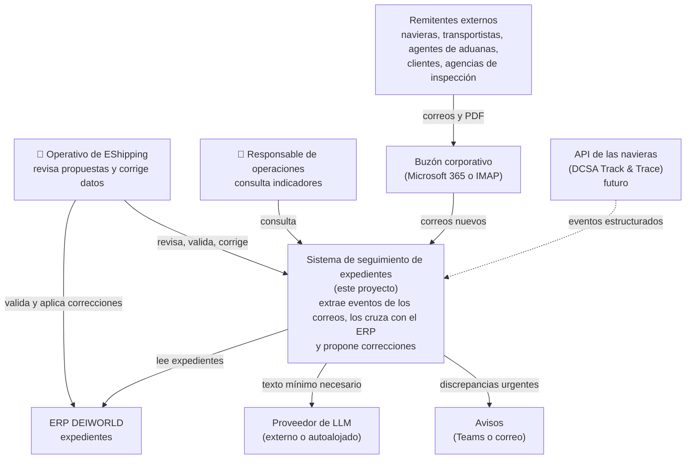
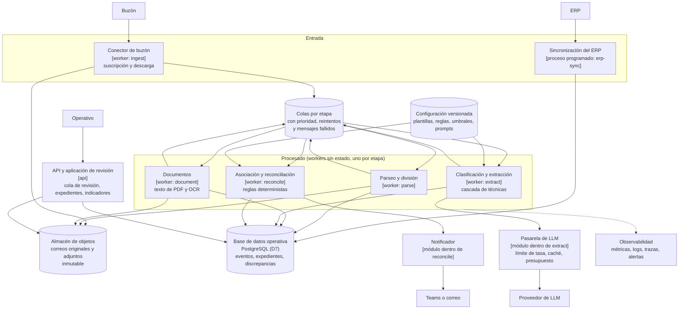
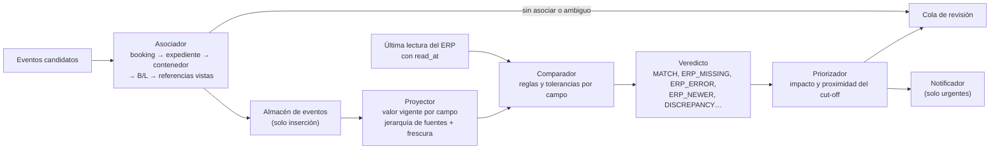
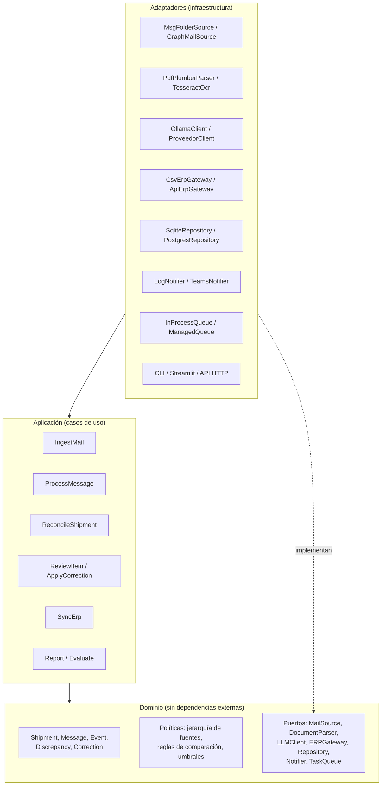

# Arquitectura

| Campo | Valor |
|---|---|
| Versión | 0.1.2 |
| Estado | Borrador |
| Responsable | Pablo Iglesias Peral |
| Última actualización | 23/11/2026 |
| Tareas | F2.1 (#15), F2.1b (#16) |
| Decisiones | [ADR-0007](adr/0007-monolito-modular-con-workers-por-etapa.md), [ADR-0008](adr/0008-estrategia-de-ia-cascada-por-etapa.md), [ADR-0009](adr/0009-politica-de-resolucion-de-discrepancias.md); pendientes D7 (#27) y D8 (#28) |
| Fuentes | [Requisitos](02_requisitos.md), [análisis de datos](01_analisis_datos.md), [taxonomía y ambigüedades](03_taxonomia_y_ambiguedades.md), [plan §7](PLAN.md#7-estándares-de-arquitectura) |

> **Confidencialidad:** sin datos reales. Las cifras de la muestra son agregadas; las de volumen son supuestos explícitos.

## 1. Resumen

- El sistema convierte cada correo operativo en **eventos de expediente con evidencia** (modelo DCSA, [ADR-0006](adr/0006-modelo-de-eventos-basado-en-dcsa.md)), los compara con el ERP mediante **reglas deterministas** y propone las correcciones a una persona, que valida. **Nunca escribe en el ERP sin validación** (RF-55).
- Estilo: **monolito modular hexagonal**, desplegado como **varios tipos de worker sin estado detrás de colas**, uno por etapa ([ADR-0007](adr/0007-monolito-modular-con-workers-por-etapa.md)). Un único código y un único modelo de dominio; cada etapa escala con réplicas por separado.
- La extracción es una **cascada de técnicas** (determinista → plantilla → ML clásico → LLM → persona): cada escalón solo recibe lo que el anterior no resuelve.
- **El volumen es pequeño en términos de cómputo.** 100.000 correos al mes son unos 23 por minuto en el pico; incluso con 300.000 al mes, todo el procesado sin LLM cabe en menos de 1,5 núcleos en el pico (§9.3). Las dificultades al crecer no están en el cómputo, sino en **cuatro cuellos de botella**: las horas de revisión humana, el coste y los límites del LLM, la frescura del ERP y el crecimiento del almacenamiento (§9.7).
- **Crecer de 100.000 a 300.000 correos al mes no cambia la arquitectura**: se cambian los parámetros de réplicas y de concurrencia y el nivel de uso del proveedor de LLM (§9.6).

## 2. Impulsores de la arquitectura

Requisitos y hallazgos que más condicionan el diseño:

| Impulsor | Origen | Consecuencia en la arquitectura |
|---|---|---|
| 100.000 correos al mes, crecimiento a 150.000 o más sin rediseño | RNF-01, RNF-02 | Workers sin estado por etapa, colas, particionado; dimensionamiento para el pico (§9) |
| Urgentes en menos de 15 minutos; el resto, en menos de 4 horas | RNF-03 | Dos carriles de prioridad decididos al principio, sin LLM (§7.1) |
| Precisión antes que cobertura; lo dudoso, a una persona | RNF-10, RNF-11, S-06 | Umbrales por campo y cola de revisión como parte central del sistema, no como añadido |
| Cada dato con evidencia, fuente, escalón, versión y confianza | RF-29, RNF-41, RNF-43 | Eventos inmutables con linaje; versionado de extractores y reglas |
| Reconciliación determinista y auditable | RF-51, PLAN §7.1 | Motor de reglas aislado del LLM; cada veredicto registra la regla y las fuentes |
| Sin escritura en el ERP sin validación humana | RF-55, S-09 | La integración con el ERP es de lectura; la escritura pasa por la aprobación en la interfaz |
| La unidad de proceso es el mensaje del hilo, no el fichero | Análisis §5.1 | Una etapa propia de división de hilos; deduplicación de citas ya vistas |
| El booking es la clave de asociación (37 de 38 asuntos) | Análisis §1 | Asociación determinista antes de cualquier modelo |
| El ERP y los correos son fotos de momentos distintos | Análisis §6.4 | Sincronización del ERP con su fecha de lectura; veredicto `ERP_NEWER` |
| Datos confidenciales; proveedores externos solo con autorización | RNF-30, RNF-31 | Pasarela de LLM con minimización y registro; datos en reposo cifrados (detalle en `09_seguridad.md`) |
| Cambiar de proveedor sin tocar el dominio | RNF-40 | Puertos y adaptadores |

## 3. Estilo arquitectónico

| Principio | Cómo se aplica |
|---|---|
| **Hexagonal** (puertos y adaptadores) | El dominio (expediente, evento, discrepancia, políticas) no importa infraestructura. Los adaptadores implementan los puertos `MailSource`, `DocumentParser`, `LLMClient`, `ERPGateway`, `Repository`, `Notifier` y `TaskQueue` (este último se añade a los del plan para desacoplar las etapas) |
| **Monolito modular** con varios tipos de worker | Un único paquete (`eshipping_ai`), varios puntos de entrada (`worker --stage=<etapa>`, `api`, `erp-sync`). Se despliega una imagen y se arranca con roles distintos ([ADR-0007](adr/0007-monolito-modular-con-workers-por-etapa.md)) |
| **Orientado a eventos** | Cada mensaje produce eventos de dominio inmutables (`EventObserved`, `DiscrepancyDetected`, `CorrectionApplied`). El estado del expediente es una **proyección** de sus eventos, recalculable |
| **Bitemporal** | Cada evento guarda cuándo ocurrió (`event_time`) y cuándo se supo (`known_at`); cada lectura del ERP guarda cuándo se hizo. Así se explica cualquier veredicto a fecha pasada (detalle en F2.3, #18) |
| **Inmutabilidad del origen** | El correo original (`.eml` o `.msg`) se guarda tal cual y no se modifica nunca. Todo lo demás se puede reconstruir a partir de él |
| **Idempotencia** | Cada etapa tiene una clave de idempotencia; reprocesar no duplica (§7.2) |
| **Configuración como datos** | Plantillas, reglas de clasificación, jerarquía de fuentes, umbrales y prompts son ficheros versionados, no código (§7.4) |
| **Humano en el bucle** | La cola de revisión es un componente de primer nivel con métricas propias, porque es el cuello de botella principal al crecer (§9.5) |

## 4. Nivel 1: contexto

| Elemento | Relación con el sistema | Requisitos |
|---|---|---|
| Buzón corporativo | Fuente principal. El sistema se suscribe a los correos nuevos (notificaciones de cambios y consultas delta en Microsoft Graph, o IMAP IDLE), no sondea | RF-01, RF-07 |
| Remitentes externos | No interactúan con el sistema: solo envían correos. Su identidad (dominio y rol) es un dato para la jerarquía de fuentes | RF-29, D6 |
| ERP DEIWORLD | **Solo lectura** desde el sistema (exportación o API, según P-09). Las correcciones validadas se aplican en el ERP por el operativo o, si EShipping lo autoriza más adelante, mediante una integración con aprobación previa | RF-50, RF-55, RF-64 |
| API de las navieras | Fuente estructurada futura con el mismo modelo de eventos DCSA; ahorra extracción de texto en las navieras que la ofrecen | RF-07, P-12 |
| Proveedor de LLM | Externo con contrato de tratamiento de datos y residencia en la UE, o autoalojado. Recibe solo el fragmento necesario, nunca el correo completo con adjuntos (decisión D5, #19; proveedores en F2.7b, #23) | RNF-30, S-10 |
| Avisos | Notificación de discrepancias urgentes con enlace a la revisión | RF-56, RNF-03 |
| Operativo | Revisa la cola, valida o corrige datos y discrepancias; sus correcciones son una fuente más (humano, `ACT`) | RF-70, RF-71 |
| Responsable de operaciones | Consulta indicadores de negocio y de calidad del sistema | RF-63 |

## 5. Nivel 2: contenedores

| Contenedor | Responsabilidad | Tecnología de referencia | Escala con | Estado del diseño |
|---|---|---|---|---|
| Conector de buzón | Recibir notificaciones de correo nuevo, descargar el original, guardarlo en el almacén de objetos y encolar su procesado. Deduplica por `Message-ID` y hash del contenido | Microsoft Graph o IMAP; adaptador `MailSource` | 1–2 réplicas (está limitado por la API del buzón, no por CPU) | Diseño; en la PoC, lectura de una carpeta (`.msg`/`.eml`) |
| Parseo y división | Parsear MIME y `.msg`, desempaquetar correos incrustados, limpiar firmas y avisos legales, dividir el hilo en mensajes y descartar los mensajes citados ya vistos | `email`, `extract-msg`, reglas | Réplicas por cola pendiente | PoC |
| Documentos | Texto de los PDF digitales; OCR solo si no hay capa de texto; plantillas de los documentos oficiales | `pdfplumber`, Tesseract; adaptador `DocumentParser` | Réplicas; es la etapa más intensiva en CPU (OCR) | PoC sin OCR (recorte); OCR si da tiempo |
| Clasificación y extracción | Triaje (prioridad y filtro de ruido), clasificación, extracción en cascada, normalización y validación, confianza | Reglas, `regex`, diccionarios, TF-IDF + regresión logística, LLM con esquema JSON | Réplicas; la concurrencia del LLM se limita en la pasarela | PoC |
| Pasarela de LLM | Único punto de salida hacia el LLM: minimización del texto, límite de tasa, reintentos, caché por hash del texto, presupuesto mensual, registro de tokens, proveedor de respaldo | Módulo del worker `extract`; adaptador `LLMClient` | Configuración: concurrencia máxima y nivel de uso del proveedor | PoC (Ollama local, [ADR-0005](adr/0005-llm-local-ollama-en-la-poc.md)) |
| Asociación y reconciliación | Asociar el mensaje al expediente, proyectar el estado vigente según la jerarquía de fuentes (D6), comparar con la última lectura del ERP y emitir discrepancias priorizadas | Motor de reglas propio, en Python, sobre la configuración versionada | Réplicas; serializa por expediente (§7.2) | PoC |
| Sincronización del ERP | Leer los expedientes del ERP de forma periódica o por cambio y guardar cada lectura con su fecha (`read_at`) | Exportación CSV o API (P-09); adaptador `ERPGateway` | Frecuencia configurable | PoC (CSV) |
| Colas | Desacoplar etapas, absorber picos, reintentos con espera exponencial, cola de mensajes fallidos, dos niveles de prioridad | Servicio gestionado de colas o PostgreSQL con `SKIP LOCKED` (D8, #28) | Gestionado | PoC: síncrono en proceso, detrás del mismo puerto `TaskQueue` |
| Almacén de objetos | Correos originales, adjuntos y textos extraídos; inmutable, cifrado, con retención | Almacenamiento de objetos compatible con S3 o equivalente (D7, D8) | Gestionado | PoC: carpeta en `data/output/` |
| Base de datos operativa | Mensajes, eventos (solo inserción), proyecciones de expediente, lecturas del ERP, discrepancias, correcciones, cola de revisión | PostgreSQL (propuesta para D7, #27), particionado mensual | Vertical; réplica de lectura para analítica | PoC: SQLite con el mismo esquema |
| Configuración versionada | Plantillas por proveedor, reglas, jerarquía de fuentes, umbrales, prompts y catálogo de eventos | Ficheros YAML en un repositorio, desplegados con una versión; cada dato registra la versión que lo produjo | — | PoC |
| API y aplicación de revisión | Cola de revisión priorizada, vista del expediente con línea temporal y evidencia, validación y corrección, indicadores | API HTTP + interfaz web; acceso con el directorio corporativo y roles (RNF-33) | Réplicas | PoC: Streamlit mínima (recorte) y CLI |
| Notificador | Avisos de discrepancias urgentes, agrupados para no saturar | Adaptador `Notifier` (Teams o correo) | — | Simulado (log) |
| Observabilidad | Métricas por etapa (rendimiento, latencia, cola pendiente, coste, confianza, porcentaje por escalón), logs estructurados sin datos personales, trazas por mensaje, alertas | OpenTelemetry y la plataforma de la nube elegida (D8) | Gestionado | PoC: métricas en la base de datos y logs estructurados |

## 6. Nivel 3: componentes

### 6.1 Worker de clasificación y extracción

Es el contenedor con más lógica y el que determina el coste. Cada componente es un paso de la cascada; un campo resuelto con confianza suficiente en un escalón no se vuelve a pedir en el siguiente.

```mermaid
flowchart LR
    in["Mensaje limpio<br/>+ textos de adjuntos"] --> tri["Triaje<br/>reglas de asunto y remitente<br/>prioridad y filtro de ruido"]
    tri -- "ruido (OTR)" --> drop["Descartado<br/>con motivo"]
    tri --> cls["Clasificador<br/>reglas → ML clásico<br/>→ LLM si baja confianza"]
    cls --> det["Extractores deterministas<br/>identificadores, ISO 6346,<br/>fechas, UN/LOCODE, buques"]
    det --> tpl["Plantillas por proveedor<br/>PDF oficiales y asuntos EDI"]
    tpl --> gap{"¿Quedan campos<br/>sin resolver?"}
    gap -- "no" --> norm
    gap -- "sí" --> llm["Extractor LLM<br/>solo los campos pendientes<br/>esquema JSON + evidencia"]
    llm --> norm["Normalizador<br/>ISO 8601 con zona y precisión,<br/>UN/LOCODE, tipos ISO 6346"]
    norm --> val["Validador<br/>esquema, reglas de dominio,<br/>evidencia presente en el texto"]
    val --> conf["Calibrador de confianza<br/>por campo y escalón"]
    conf --> out["Eventos candidatos<br/>→ cola de reconciliación"]
```

| Componente | Entrada → salida | Técnica | Requisitos |
|---|---|---|---|
| Triaje | Mensaje → prioridad (`urgent`/`normal`) y decisión de descarte | Reglas configurables sobre asunto, remitente y palabras clave (cut-off, cambio de buque, retraso, roleo). Barato y sin LLM, para que la prioridad se decida antes de esperar a nadie | RF-12, RNF-03 |
| Clasificador | Mensaje → clases de la taxonomía con confianza | Reglas → TF-IDF + regresión logística entrenado con las correcciones → LLM solo si las dos anteriores no llegan al umbral | RF-10, RF-11 |
| Extractores deterministas | Texto → identificadores, contenedores validados, fechas, puertos, buques | Expresiones regulares con contexto, ISO 6346 completo, parser de fechas con el perfil del remitente, diccionarios UN/LOCODE y de buques con coincidencia aproximada | RF-20 a RF-23, RF-40, RF-42, RF-73 |
| Plantillas | PDF o asunto estructurado → campos | Anclas de texto por tipo de documento y proveedor, definidas en YAML | RF-27, RF-30 |
| Extractor LLM | Fragmento y lista de campos pendientes → valores con su cita literal | LLM con salida restringida a un esquema JSON; solo recibe el mensaje nuevo, no el hilo completo ya procesado | RF-24, RF-25, RF-28 |
| Normalizador | Valores en bruto → valores canónicos | Reglas | RF-40 a RF-42 |
| Validador | Valores → aceptados o descartados con motivo | Pydantic y reglas de dominio; se exige que la evidencia aparezca literalmente en el texto de origen (control de alucinaciones) | RF-41, RF-29 |
| Calibrador | Puntuaciones del escalón → confianza calibrada | Calibración por campo y escalón con las correcciones (F2.6, #21) | RNF-12 |

### 6.2 Worker de asociación y reconciliación

| Componente | Responsabilidad | Requisitos |
|---|---|---|
| Asociador | Clave determinista por este orden: booking, expediente, contenedor, B/L, referencias ya vistas del hilo; gestiona alias (booking nuevo tras roleo, expediente truncado). Sin clave o con varias candidatas → revisión | RF-43 a RF-45, RNF-10 |
| Almacén de eventos | Inserta eventos inmutables con linaje y versión del extractor. Las correcciones humanas son eventos de fuente `humano` | RF-29, RF-60, RF-61, RF-70 |
| Proyector | Calcula el valor vigente de cada campo del expediente según la jerarquía de fuentes por campo y `known_at` (D6, #20) | RF-53 |
| Comparador | Compara el valor vigente con la lectura del ERP con reglas y tolerancias por campo; tiene en cuenta `read_at` frente a `known_at` para no alertar cuando el ERP es más reciente | RF-51, RF-52, RF-54 |
| Priorizador | Ordena por impacto (campo crítico, proximidad del cut-off o de la salida) | RF-56 |
| Notificador | Avisa solo de lo urgente, agrupado por expediente | RNF-03 |

### 6.3 Dominio, aplicación y adaptadores (estructura del código)

Regla de dependencias (RNF-40): `domain` no importa nada de `application` ni de `adapters`, y `application` no importa `adapters`. Se comprobará en el CI con contratos de importación (`import-linter`) desde F3.1 (#29).

## 7. Funcionamiento de la canalización

| # | Etapa | Entrada | Salida | Clave de idempotencia | Si falla |
|---|---|---|---|---|---|
| 1 | Ingesta | Notificación del buzón | Original en el almacén de objetos + tarea `parse` | `Message-ID` + SHA-256 del original | Reintento; el buzón conserva el correo |
| 2 | Parseo y división | Original | Mensajes limpios (nuevos) + tareas `document` y `extract` | SHA-256 del texto normalizado de cada mensaje | Reintento; tras N intentos, mensajes fallidos y revisión |
| 3 | Documentos | Adjunto PDF | Texto y campos de plantilla | SHA-256 del adjunto | Sin texto ni OCR posible → se marca y sigue sin él |
| 4 | Extracción | Mensaje + textos de adjuntos | Eventos candidatos | (mensaje, versión de la configuración) | LLM caído → circuito abierto: los campos deterministas siguen; el resto espera en la cola o pasa al proveedor de respaldo |
| 5 | Reconciliación | Eventos candidatos | Eventos, proyección, discrepancias, tareas de revisión | (expediente, conjunto de eventos, versión de las reglas) | Reintento; serializado por expediente |

### 7.1 Prioridades

- El **triaje** decide la prioridad en la etapa 4 con reglas, antes de cualquier llamada al LLM; las etapas 1 y 2 son tan rápidas (§9.3) que no necesitan carril propio.
- Hay dos carriles: `urgent` (cambios de cut-off, de buque o de salida, roleos) y `normal`. Los workers consumen siempre primero el carril urgente.
- Presupuesto de latencia de un urgente (p95, objetivo de menos de 15 minutos, RNF-03): notificación del buzón menos de 1 minuto, parseo y triaje unos segundos, LLM menos de 1 minuto con reintentos, reconciliación y aviso unos segundos. El margen restante absorbe colas en un pico.
- Las **API por lotes** de los proveedores de LLM (con descuento) **no sirven para el flujo normal**: su plazo de entrega habitual (hasta 24 horas) no cumple las 4 horas de RNF-03. Se usan para reprocesados masivos y para evaluación.

### 7.2 Idempotencia, orden y reprocesado

- Cada etapa escribe con su clave de idempotencia (`INSERT … ON CONFLICT DO NOTHING`); una tarea repetida no duplica nada (RNF-04).
- **Deduplicación de citas:** un mismo mensaje citado en veinte respuestas se procesa una sola vez, porque su hash ya existe. Solo el texto nuevo llega a la extracción, lo que reduce tokens y coste.
- **Orden:** los correos pueden llegar desordenados; no importa, porque la proyección se calcula por `known_at` y no por orden de llegada. La reconciliación de un mismo expediente se serializa (bloqueo consultivo por expediente en la base de datos) para que dos workers no proyecten a la vez.
- **Reprocesado:** como el original es inmutable y cada dato guarda la versión que lo produjo, una nueva versión de reglas, plantillas o prompts se puede aplicar a un rango de fechas reencolando los originales. Las proyecciones se recalculan; los eventos antiguos no se borran, se marcan como sustituidos.

### 7.3 Fallos

- Reintentos con espera exponencial y fluctuación aleatoria; tras el máximo, cola de mensajes fallidos con alerta.
- **Pasarela de LLM:** límite de tasa propio por debajo del del proveedor, interruptor de circuito, proveedor de respaldo configurable (otro proveedor o el modelo autoalojado) y presupuesto mensual con alerta al 80 %.
- **ERP no disponible:** la reconciliación usa la última lectura y lo indica (`read_at`); no se emiten veredictos `ERP_ERROR` con una lectura más antigua que un umbral configurable.
- Ningún fallo pierde un correo: el original está guardado antes de confirmar la ingesta.

### 7.4 Configuración y versionado

Lo que cambia con el negocio es configuración, no código (PLAN §7.2):

| Configuración | Ejemplo de cambio | Quién lo cambia |
|---|---|---|
| Plantillas por proveedor | Una naviera nueva con su formato de confirmación | Equipo técnico, con una plantilla nueva y sus tests sintéticos |
| Reglas de triaje y clasificación | Una palabra clave nueva de urgencia | Equipo técnico, a propuesta de operaciones |
| Jerarquía de fuentes y tolerancias | La naviera prevalece sobre el cliente en la salida | Operaciones y equipo técnico (D6) |
| Umbrales de confianza | Subir el umbral de la salida del buque | Equipo técnico, con los datos de calibración (F2.6) |
| Prompts y modelo | Cambio de modelo o de proveedor | Equipo técnico, tras evaluar contra el conjunto de referencia |

La configuración vive en un repositorio con revisión por PR, se despliega con un número de versión y **cada evento guarda la versión** de la configuración y del extractor que lo produjo (RNF-41).

## 8. Reglas de escalabilidad y mantenibilidad aplicadas

| Regla del plan (§7.2) | Dónde se aplica |
|---|---|
| Workers sin estado detrás de colas, escalado por etapa | §5: cinco roles de worker independientes |
| Desacoplamiento, presión entre etapas, reintentos y mensajes fallidos | §7.3 |
| Idempotencia en todas las etapas | §7.2 |
| Lotes cuando el proveedor lo permite; tiempo real solo para lo urgente | §7.1: lotes solo en reprocesados y evaluación, porque el flujo normal tiene un plazo de 4 horas |
| Cascada de técnicas | §6.1 |
| Almacenamiento particionado e indexado | §5: partición mensual; índices por expediente, booking y contenedor |
| Límites externos con colas y limitación de tasa | Pasarela de LLM (§7.3) y conector de buzón (§4) |
| Coste proporcional, por mes y por correo | §9 y `06_costes.md` (F2.7, #22) |
| Hexagonal | §6.3 |
| Configuración y no código | §7.4 |
| Versionado de todo lo que afecta al resultado | §7.4 |
| Observabilidad | §5 |

## 9. Análisis de capacidad (F2.1b)

### 9.1 Parámetros

Todas las cifras de esta sección salen de estos parámetros. Los marcados como hipótesis se miden en la PoC (F4.3, #41, y F4.4, #42) o se preguntan a EShipping.

| Parámetro | Valor | Origen |
|---|---|---|
| Correos al mes | 100.000, 150.000 y 300.000 (2× sobre 150.000) | S-01, RNF-02 |
| Días y horas de actividad | 22 días laborables, 10 horas al día | S-02 |
| Factor de pico sobre la media horaria | 3× | S-02 |
| Correos sin relación con un expediente (ruido, `OTR`) | 25 % | Hipótesis (P-01) |
| Mensajes nuevos por correo operativo tras deduplicar citas | 1,5 | Hipótesis (en producción llega cada respuesta por separado, no el contenedor de la muestra) |
| PDF por correo | 0,6 | Muestra: 23 PDF en 38 correos (no extrapolable, S-04) |
| PDF escaneados (con OCR) | 13 %, 2 páginas de media | Muestra: 3 de 23 |
| Correos operativos que necesitan el LLM para algún campo | 50 % | Hipótesis conservadora; se mide como porcentaje por escalón (RNF-21) |
| Tokens por llamada al LLM | 3.000 de entrada, 400 de salida | Hipótesis (solo el mensaje nuevo, más instrucciones y esquema); se mide en F4.4 |
| Tiempo de CPU por unidad (1 vCPU) | Parseo y limpieza 0,1 s por correo; texto de PDF 0,5 s por PDF; OCR 5 s por página; extracción sin LLM 0,05 s por mensaje; reconciliación 0,05 s por correo | Hipótesis (órdenes de magnitud habituales de estas librerías); se mide en F4.4 |
| Latencia de una llamada al LLM | 8 s | Hipótesis |
| Tamaño del original con adjuntos | 250 KB de media | Hipótesis (PDF de la muestra entre 9 y 770 KB) |
| Eventos por correo operativo | 4 | Hipótesis |
| Utilización objetivo de un worker | 60 % (margen para ráfagas) | Diseño |
| Réplicas mínimas por etapa | 2 (disponibilidad) | Diseño |

### 9.2 Carga

| | 100.000/mes | 150.000/mes | 300.000/mes |
|---|---|---|---|
| Media por hora de actividad | 455 | 682 | 1.364 |
| Pico por hora | 1.364 | 2.045 | 4.091 |
| Pico por minuto | 23 | 34 | 68 |
| Correos operativos al mes | 75.000 | 112.500 | 225.000 |

### 9.3 Cómputo por etapa en el pico

Núcleos de CPU ocupados en la hora pico (carga × tiempo por unidad):

| Etapa | 100.000/mes | 150.000/mes | 300.000/mes | Réplicas (mín. 2, 60 % de uso) |
|---|---|---|---|---|
| Parseo y división | 0,04 | 0,06 | 0,11 | 2 en los tres casos |
| Texto de PDF | 0,11 | 0,17 | 0,34 | 2 |
| OCR | 0,30 | 0,44 | 0,89 | 2 |
| Extracción sin LLM | 0,02 | 0,03 | 0,06 | 2 |
| Reconciliación | 0,01 | 0,02 | 0,04 | 2 |
| **Total** | **0,48** | **0,72** | **1,45** | — |

**Conclusión:** con estos volúmenes, el número de réplicas lo fija la **disponibilidad**, no la carga. La arquitectura con workers por etapa no se justifica por rendimiento, sino porque permite **aislar fallos y escalar solo la etapa que lo necesite** cuando cambie la mezcla de correos (por ejemplo, si EShipping tiene muchos más escaneados de los que muestra la muestra, solo crece el worker de documentos). Aunque los tiempos por unidad fueran diez veces peores que la hipótesis, a 300.000 correos al mes harían falta unos 15 núcleos en el pico: sigue siendo una cuestión de configuración.

### 9.4 LLM

| | 100.000/mes | 150.000/mes | 300.000/mes |
|---|---|---|---|
| Llamadas al mes | 37.500 | 56.250 | 112.500 |
| Tokens al mes (entrada / salida) | 112 M / 15 M | 169 M / 22,5 M | 338 M / 45 M |
| Llamadas por minuto en el pico | 8,5 | 12,8 | 25,6 |
| Peticiones simultáneas en el pico (llamadas por segundo × latencia) | 1,1 | 1,7 | 3,4 |
| Tokens por minuto en el pico | ≈ 29.000 | ≈ 43.000 | ≈ 87.000 |

- La concurrencia necesaria es muy baja: el LLM **no es un cuello de botella de rendimiento**, sino de **coste y de dependencia externa**. Los tokens por minuto del pico están dentro de los límites habituales de los niveles de uso de pago de los proveedores; se comprueba con cada proveedor en la comparativa (F2.7b, #23).
- Si se autoaloja el modelo, unas 3–4 peticiones simultáneas con un modelo de 4 a 8 mil millones de parámetros caben en una sola GPU con margen; la comparación de coste se hace en F2.7b.
- El coste crece **linealmente** con el volumen y con el porcentaje que llega al LLM. Por eso la palanca principal es la cascada: pasar del 50 % al 25 % de correos con LLM tiene el mismo efecto en coste que no crecer de 150.000 a 300.000. El coste en euros se calcula en `06_costes.md` (F2.7, #22).

### 9.5 Almacenamiento

| | 100.000/mes | 150.000/mes | 300.000/mes |
|---|---|---|---|
| Originales y adjuntos al mes | 25 GB | 38 GB | 75 GB |
| Originales y adjuntos al año | 300 GB | 450 GB | 900 GB |
| Eventos al mes | 300.000 | 450.000 | 900.000 |
| Base de datos al mes (eventos con evidencia, 2 KB por fila, sin índices) | 0,6 GB | 0,9 GB | 1,8 GB |

- El almacén de objetos crece más deprisa, pero es el almacenamiento más barato y admite niveles de archivo; la retención la fija `09_seguridad.md` (F2.9, #25).
- La base de datos operativa crece unos 10–25 GB al año contando índices: PostgreSQL lo maneja sin problemas con particiones mensuales. Las particiones antiguas se pueden archivar y la analítica se lleva a una réplica de lectura o a un almacén analítico si las consultas lo requieren (D7, #27).

### 9.6 Revisión humana: el cuello de botella real

Elementos a revisar al mes (porcentaje de correos operativos con algún elemento en revisión × 1,5 minutos de media por elemento; 154 horas productivas al mes por persona):

| Porcentaje en revisión | 100.000/mes | 150.000/mes | 300.000/mes |
|---|---|---|---|
| 30 % (arranque, umbrales prudentes) | 562 h ≈ 3,7 personas | 844 h ≈ 5,5 personas | 1.688 h ≈ 11 personas |
| 15 % (objetivo RNF-13) | 281 h ≈ 1,8 personas | 422 h ≈ 2,7 personas | 844 h ≈ 5,5 personas |
| 8 % (régimen maduro, con aprendizaje) | 150 h ≈ 1,0 persona | 225 h ≈ 1,5 personas | 450 h ≈ 2,9 personas |

- Es el único recurso que **escala linealmente y no se resuelve con réplicas**. A 300.000 correos al mes con un 15 % de revisión harían falta más de 5 personas dedicadas.
- Por eso la arquitectura trata la revisión como un componente de primer nivel: cola priorizada por impacto, la evidencia a la vista para decidir en segundos, agrupación por expediente y medición del porcentaje en revisión por campo y por proveedor.
- La palanca es el **aprendizaje continuo** (F2.8, #24): cada corrección validada se convierte en una plantilla, una regla o un ejemplo, y baja el porcentaje en revisión del proveedor afectado. El objetivo de diseño es que el volumen crezca más deprisa que las horas de revisión.
- La comparación relevante para EShipping no es frente a cero horas, sino frente a la situación actual, en la que una persona lee **todos** los correos (P-06).

### 9.7 Cuellos de botella y mitigaciones

| Cuello de botella | Por qué | Mitigación en el diseño |
|---|---|---|
| Horas de revisión humana | Crece linealmente con el volumen (§9.6) | Umbrales por campo calibrados, cola priorizada, aprendizaje por proveedor, objetivo medible por escalón |
| Coste del LLM y límites del proveedor | Crece linealmente; dependencia de un tercero | Cascada, solo el mensaje nuevo, caché por hash, presupuesto con alerta, proveedor de respaldo, límite de tasa propio |
| Frescura del ERP | Sin la fecha de actualización de cada campo no se distingue un error de una actualización (análisis §6.4) | Lectura con `read_at`, veredicto `ERP_NEWER`, sincronización por cambio si DEIWORLD lo permite (P-07, P-09) |
| Límites de la API del buzón | Microsoft Graph limita las peticiones por buzón | Notificaciones de cambios y consultas delta, sin sondeo; un conector por buzón |
| Crecimiento del almacenamiento | Originales y adjuntos | Niveles de archivo y retención definida (F2.9) |
| Contención por expediente | Dos mensajes del mismo expediente a la vez | Serialización por expediente solo en la reconciliación (§7.2) |

### 9.8 Qué cambia al crecer

| Paso | Qué se cambia | ¿Código? |
|---|---|---|
| 100.000 → 150.000 al mes | Nada obligatorio. Revisar el nivel de uso del proveedor de LLM y el presupuesto | No |
| 150.000 → 300.000 al mes | Réplicas del worker de documentos si sube la proporción de escaneados; concurrencia de la pasarela; tamaño de la instancia de la base de datos | No |
| 300.000 → 1 millón al mes | Réplicas por etapa, réplica de lectura para la interfaz y la analítica, posible almacén analítico separado, varios conectores de buzón | No (la analítica separada es un adaptador nuevo) |
| Mucho más (varios millones o eventos de las API de navieras en tiempo real) | Reparto de la reconciliación por expediente entre particiones de la cola; base de datos con particionado por expediente | Cambios acotados en adaptadores, no en el dominio |
| Cambio de la mezcla de correos (más idiomas, aéreo, importación, LCL) | Plantillas, reglas y catálogo de eventos | No (configuración), salvo eventos nuevos en el dominio |

### 9.9 Validación

- **F4.4 (#42):** se miden en la PoC los tiempos por unidad, los tokens por llamada y la memoria, y se recalculan las tablas de §9.3 a §9.5.
- **F4.3 (#41):** se mide el porcentaje resuelto en cada escalón, que fija el porcentaje real que llega al LLM y a revisión.
- **F4.5 (#44):** prueba de volumen con correos sintéticos generados a partir de plantillas para comprobar el rendimiento por worker y extrapolar al pico.

## 10. Trazabilidad: requisitos y componentes

Criterio de salida de F2: cada requisito de F1 está cubierto por un componente.

| Requisitos | Componente |
|---|---|
| RF-01, RF-06, RF-07 | Conector de buzón (y conector de API de navieras, futuro) |
| RF-02, RF-03, RF-04 | Parseo y división |
| RF-05, RF-27, RF-30 | Documentos y plantillas |
| RF-10, RF-11, RF-12 | Triaje y clasificador |
| RF-20 a RF-26, RF-28 | Extractores deterministas, plantillas y extractor LLM |
| RF-29 | Validador y almacén de eventos (evidencia y linaje) |
| RF-40 a RF-42 | Normalizador y validador |
| RF-43 a RF-45 | Asociador |
| RF-50 | Sincronización del ERP |
| RF-51 a RF-54, RF-56 | Proyector, comparador y priorizador |
| RF-55 | API y aplicación de revisión (la única vía de cambio del ERP pasa por la validación humana) |
| RF-60, RF-61 | Base de datos operativa (eventos bitemporales) y almacén de objetos |
| RF-62, RF-63 | API y aplicación de revisión |
| RF-64 | Exportación del expediente enriquecido (adaptador futuro del `ERPGateway`) |
| RF-70 a RF-73 | Aplicación de revisión, configuración versionada y calibrador (F2.8) |
| RNF-01 a RNF-04 | Workers por etapa, colas con prioridad e idempotencia (§7, §9) |
| RNF-10 a RNF-14 | Calibrador, umbrales y cola de revisión (F2.6) |
| RNF-20, RNF-21 | Pasarela de LLM (registro de tokens) y métricas por escalón |
| RNF-30 a RNF-33 | Pasarela de LLM (minimización), almacenamiento cifrado, logs sin datos personales, acceso por rol (F2.9) |
| RNF-40 a RNF-44 | Hexagonal, configuración versionada, observabilidad, motor de reglas con traza, CI |

## 11. Decisiones

| Decisión | Estado | Dónde |
|---|---|---|
| Monolito modular con workers por etapa y colas | Aceptada | [ADR-0007](adr/0007-monolito-modular-con-workers-por-etapa.md) |
| D5: estrategia de IA y técnica por etapa | Aceptada | [ADR-0008](adr/0008-estrategia-de-ia-cascada-por-etapa.md) |
| D6: política de resolución de discrepancias | Aceptada | [ADR-0009](adr/0009-politica-de-resolucion-de-discrepancias.md) |
| D7: almacenamiento de producción (propuesta: PostgreSQL + almacén de objetos) | Pendiente | #27 |
| D8: plataforma de despliegue y servicio de colas | Pendiente | #28 |

Los diagramas de secuencia de los flujos principales se añaden en F2.2 (#17).

## Historial

| Versión | Fecha | Cambios |
|---|---|---|
| 0.1.0 | 23/11/2026 | Primera versión: impulsores, estilo, C4 niveles 1 a 3, funcionamiento de la canalización y análisis de capacidad a 100.000, 150.000 y 300.000 correos al mes |
| 0.1.1 | 23/11/2026 | D5 aceptada (ADR-0008) |
| 0.1.2 | 23/11/2026 | D6 aceptada (ADR-0009) |
