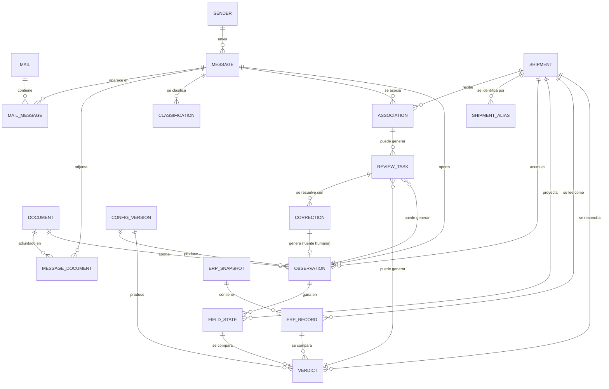
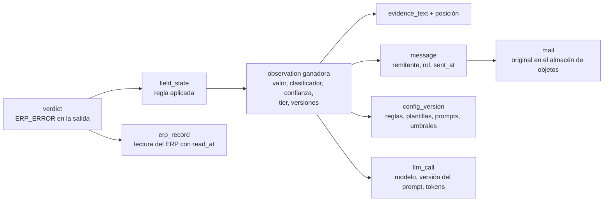

# Modelo de datos, linaje y bitemporalidad

| Campo | Valor |
|---|---|
| Versión | 0.1.1 |
| Estado | Borrador |
| Responsable | Pablo Iglesias Peral |
| Última actualización | 23/11/2026 |
| Tarea | F2.3 (#18) |
| Requisitos | RF-03, RF-06, RF-29, RF-43, RF-44, RF-50 a RF-53, RF-55, RF-60, RF-61, RF-70, RNF-04, RNF-41, RNF-43 |
| Decisiones relacionadas | [ADR-0006](adr/0006-modelo-de-eventos-basado-en-dcsa.md) (eventos DCSA), [ADR-0007](adr/0007-monolito-modular-con-workers-por-etapa.md) (workers y colas), [ADR-0009](adr/0009-politica-de-resolucion-de-discrepancias.md) (valor vigente y veredictos); almacenamiento de producción pendiente (D7, #27) |

> **Confidencialidad:** sin datos reales. Los ejemplos son sintéticos.

## 1. Resumen

- **Tres capas.** Lo que llega se guarda tal cual (correos, mensajes, documentos y lecturas del ERP). Lo que el sistema **observa** en ello se guarda como **observaciones inmutables**: cada una es una afirmación de una fuente sobre un evento, con su cita. Lo que el sistema **concluye** (el valor vigente de cada campo, los veredictos frente al ERP) es una **proyección** que se puede recalcular.
- **Nada se borra ni se sobrescribe** en las dos primeras capas: una observación corregida o sustituida se marca, y la corrección es otra observación. Así se cumple el linaje (RF-60) y se puede reprocesar (RNF-04).
- **Bitemporal:** cada observación tiene cuándo ocurre el hecho (`event_time`), cuándo lo dijo la fuente (`known_at`) y cuándo lo registró el sistema (`recorded_at`); cada lectura del ERP tiene su `read_at`. Con eso se responde «qué se sabía de este expediente el día X» (RF-61) y se explica cualquier veredicto a posteriori.
- **Linaje completo:** desde un veredicto se llega a la observación ganadora, de ahí al mensaje y al fragmento literal, al correo original guardado en el almacén de objetos, y a las versiones del extractor y de la configuración que lo produjeron (RNF-41, RNF-43).
- **Dos almacenes:** los contenidos voluminosos y con datos personales (correos originales, cuerpos limpios, PDF y su texto) van al almacén de objetos, cifrados. La base de datos guarda metadatos, observaciones con su cita corta y proyecciones.

## 2. Diagrama entidad-relación



## 3. Capa de entrada (inmutable)

### 3.1 Correo, mensaje y documento

| Entidad | Qué es | Campos principales | Clave de idempotencia |
|---|---|---|---|
| `mail` | Un correo tal como llega del buzón (en la PoC, cada `.msg` contenedor y cada correo incrustado) | `mail_id`, `rfc_message_id`, `sha256`, `mailbox`, `received_at`, `raw_object_key`, `size_bytes`, `parent_mail_id` (si venía incrustado en otro) | `rfc_message_id` + `sha256` |
| `message` | Un mensaje de un hilo, tras dividirlo; un mismo mensaje puede aparecer citado en muchos correos | `message_id`, `content_hash`, `sender_id`, `sent_at`, `subject`, `language`, `clean_body_key`, `first_seen_mail_id` | `content_hash` (SHA-256 del texto normalizado) |
| `mail_message` | En qué correos aparece cada mensaje y en qué posición | `mail_id`, `message_id`, `depth` (0 = mensaje nuevo, 1+ = citado), `is_new` | (`mail_id`, `message_id`) |
| `document` | Un adjunto, una vez por contenido | `document_id`, `sha256`, `filename`, `mime_type`, `object_key`, `text_key`, `has_text_layer`, `ocr_applied`, `doc_type` (plantilla reconocida), `pages` | `sha256` |
| `message_document` | Qué mensaje adjunta qué documento | `message_id`, `document_id` | (`message_id`, `document_id`) |

`sent_at` es la fecha de la cabecera del propio mensaje (citado o no), no la del correo que lo reenvía: es la base del `known_at` de todo lo que se extrae de él (RF-03, A-14).

### 3.2 Remitentes

| Entidad | Qué es | Campos principales |
|---|---|---|
| `sender` | Remitente conocido | `sender_id`, `address`, `domain` |
| `sender_directory` | Rol de fuente por dominio o dirección ([ADR-0009 §1](adr/0009-politica-de-resolucion-de-discrepancias.md#1-rol-de-la-fuente)) | `pattern`, `role`, `validated_by`, `valid_from`, `valid_to` |
| `sender_profile` | Lo aprendido de cada remitente (RF-73) | `sender_id`, `date_order` (día-mes o mes-día), `reliability` por campo, `templates`, `updated_at` |

### 3.3 Lecturas del ERP

| Entidad | Qué es | Campos principales |
|---|---|---|
| `erp_snapshot` | Una lectura completa o incremental del ERP | `snapshot_id`, `read_at`, `source` (fichero CSV o API), `sha256`, `row_count` |
| `erp_record` | La fila de un expediente en una lectura | `snapshot_id`, `operation` (número de expediente), `raw` (columnas originales), `normalized` (campos normalizados: booking, buque, salida y su indicador, llegada, carga, despacho, puertos, equipo), `field_updated_at` (si DEIWORLD lo expone, P-07) |

Cada lectura se conserva. La reconciliación siempre indica qué lectura usó, y una auditoría puede ver qué decía el ERP en cualquier fecha.

## 4. Capa de observación (inmutable)

### 4.1 Expediente y sus identificadores

| Entidad | Qué es | Campos principales |
|---|---|---|
| `shipment` | Un expediente | `shipment_id` (interno), `erp_operation` (si se conoce), `created_at` |
| `shipment_alias` | Cada identificador con el que se reconoce el expediente: booking (también los anteriores tras un roleo o una enmienda), expediente, contenedor, B/L, referencia del cliente, referencia de aduana | `shipment_id`, `alias_type`, `value_normalized`, `valid_from`, `valid_to`, `source_observation_id` |

`shipment_alias` es el **índice de asociación**: el asociador busca aquí, en el orden del [ADR-0009](adr/0009-politica-de-resolucion-de-discrepancias.md) y de RF-43, los identificadores encontrados en el mensaje (RF-44).

### 4.2 Clasificación y asociación

| Entidad | Qué es | Campos principales |
|---|---|---|
| `classification` | Clases de un mensaje | `message_id`, `class`, `is_primary`, `confidence`, `tier`, `extractor_version`, `config_version` |
| `association` | Un mensaje asociado a un expediente | `message_id`, `shipment_id`, `method` (`booking`, `operation`, `container`, `bl`, `thread_ref`, `human`), `matched_value`, `confidence`, `status` (`auto`, `in_review`, `confirmed`, `rejected`), `config_version` |

Un mensaje puede asociarse a varios expedientes (A-19); cada observación indica a qué expediente pertenece.

### 4.3 Observación

Es la entidad central. Una observación es **lo que una fuente dijo sobre un hecho**, no el hecho en sí: el mismo evento tiene tantas observaciones como veces se mencione.

| Grupo | Campos | Notas |
|---|---|---|
| Identidad | `observation_id`, `shipment_id`, `idempotency_key` | Clave: (mensaje o documento, expediente, campo, valor normalizado, versión del extractor); incluye el expediente porque un mensaje puede hablar de varios (A-19) |
| Qué | `event_type` (DCSA: `DEPA`, `ARRI`, `STUF`, `CUS-REL`…), `classifier` (`PLN`, `EST`, `ACT`), `field` (por ejemplo, `vessel_departure.time`, `vessel.name`, `container.number`) | Modelo del [ADR-0006](adr/0006-modelo-de-eventos-basado-en-dcsa.md) |
| Valor | `value` (normalizado), `value_raw` (texto original), `event_time`, `event_time_end` (rangos), `time_precision` (`datetime`, `date`, `range`, `approx`), `timezone`, `location_unlocode`, `location_raw`, `vessel`, `voyage`, `equipment` | Tipado por campo en el dominio (F3.1) |
| Fuente | `message_id` o `document_id`, `source_role`, `source_rank` (A, B o C para ese campo) | El rol es el del autor original (A-16) |
| Evidencia | `evidence_text` (cita literal, corta), `evidence_start`, `evidence_end` (posición en el texto limpio guardado) | La cita completa se puede releer desde el almacén de objetos |
| Tiempo | `known_at` (fecha del mensaje), `recorded_at` (cuándo lo guardó el sistema) | §6 |
| Procedencia | `tier` (`rule`, `template`, `ml`, `llm`, `human`), `extractor_version`, `config_version`, `llm_call_id` (si aplica) | RNF-41 |
| Fiabilidad | `confidence` (calibrada), `zone` (`auto`, `review`, `not_proposed`) | [Fiabilidad §4.3](07_fiabilidad.md#43-tres-zonas) |
| Ciclo de vida | `status` (`active`, `superseded`, `rejected`), `superseded_by`, `superseded_at`, `discard_reason` | Nunca se borra; solo cambia el estado |

Las correcciones de un operativo son observaciones con `tier = human`, `source_role = human_review` y `classifier = ACT` (taxonomía §5), enlazadas a su corrección.

## 5. Capa de conclusión (proyecciones recalculables)

| Entidad | Qué es | Campos principales |
|---|---|---|
| `field_state` | Valor vigente de cada campo del expediente según los correos | `shipment_id`, `field`, `value`, `winning_observation_id`, `rule` (la regla del ADR-0009 §3 que decidió), `in_conflict`, `pending_confirmation` (lista de observaciones de rango C), `computed_at`, `config_version` |
| `verdict` | Comparación de un campo con una lectura del ERP | `verdict_id`, `shipment_id`, `field`, `verdict` (`MATCH`, `ERP_MISSING`, `ERP_ERROR`, `ERP_NEWER`, `DISCREPANCY`, `MAIL_MISSING`, `NOT_IN_ERP`), `mail_value`, `erp_value`, `field_state_ref`, `erp_record_ref`, `rule`, `priority` (P1–P3), `status` (`open`, `proposed`, `accepted`, `rejected`, `superseded`), `computed_at`, `config_version` |
| `erp_quality_issue` | Incoherencia interna del ERP (ADR-0009 §5) | `shipment_id`, `rule`, `details`, `erp_record_ref` |

Las proyecciones se pueden borrar y recalcular a partir de las observaciones y las lecturas del ERP. Los veredictos sí se **conservan** una vez mostrados a una persona (para auditar lo que se le propuso); si cambian, el anterior pasa a `superseded`.

## 6. Bitemporalidad

### 6.1 Las cuatro fechas

| Fecha | Dónde | Significado | Ejemplo sintético |
|---|---|---|---|
| `event_time` | Observación | Cuándo ocurre (u ocurrirá) el hecho: tiempo válido | La salida del buque, el 22/09 |
| `known_at` | Observación | Cuándo lo dijo la fuente: fecha del mensaje | La naviera lo escribió el 10/09 |
| `recorded_at` | Observación | Cuándo lo registró el sistema | Se procesó el 10/09 a los 2 minutos, o el 15/10 si se reprocesó |
| `read_at` | Lectura del ERP | Cuándo se leyó el ERP | Exportación del 12/09 |

`known_at` y `recorded_at` son dos tiempos de transacción distintos. Normalmente casi coinciden; se separan cuando se reprocesa un histórico o llega un correo con retraso. Por eso hay dos preguntas «a fecha X»:

- **Qué decían las fuentes el día X** (para explicar una decisión operativa): observaciones con `known_at ≤ X`.
- **Qué sabía el sistema el día X** (para auditar el sistema): observaciones con `recorded_at ≤ X` y la configuración vigente entonces.

### 6.2 Consulta «estado del expediente a fecha X» (RF-61)

```sql
-- Observaciones de las que se podía saber el 15/09 (sintético)
SELECT o.*
FROM observation o
WHERE o.shipment_id = :shipment_id
  AND o.known_at <= :as_of            -- lo que habían dicho las fuentes
  AND o.recorded_at <= :as_of         -- y que el sistema ya había registrado
  AND (o.status = 'active'
       OR o.superseded_at > :as_of);  -- lo sustituido después aún valía entonces
```

Sobre ese conjunto se aplica el mismo proyector que en tiempo real (ADR-0009 §3), con la versión de la configuración vigente en `:as_of`, y se compara con la última lectura del ERP con `read_at ≤ :as_of`. El resultado reproduce el veredicto que el sistema habría dado ese día.

### 6.3 Línea temporal de un expediente

La vista de la interfaz (RF-62) muestra, para cada evento, sus observaciones ordenadas por `known_at`: qué se planificó, cómo cambió la estimación y cuándo ocurrió, con la fuente y la cita de cada paso.

## 7. Linaje

Cadena de un veredicto hasta el origen (RF-60, RNF-43):



Cada salto es una clave ajena; no hace falta reconstruir nada a partir de logs.

## 8. Tablas operativas

| Entidad | Qué es | Campos principales |
|---|---|---|
| `review_task` | Tarea de la cola de revisión | `task_id`, `kind` (`association`, `field`, `conflict`, `verdict`, `audit`), referencias a lo revisado, `priority`, `status`, `assigned_to`, `created_at`, `resolved_at`, `second_review_of` (doble revisión) |
| `correction` | Decisión de un operativo | `correction_id`, `task_id`, `user_id`, `action` (`accept`, `correct`, `reject`), `new_value`, `reason`, `created_at`, `generated_observation_id` |
| `erp_change_proposal` | Propuesta aceptada para aplicar en el ERP (RF-55, RF-64) | `proposal_id`, `verdict_id`, `field`, `from_value`, `to_value`, `approved_by`, `approved_at`, `exported_at` |
| `config_version` | Cada versión desplegada de la configuración | `version`, `sha256`, `deployed_at`, `components` (reglas, plantillas, umbrales, prompts y modelos con su versión) |
| `task_queue` | Colas entre etapas (ADR-0007; sobre PostgreSQL con `SKIP LOCKED`) | `task_id`, `stage`, `priority`, `idempotency_key`, `payload_ref`, `status`, `attempts`, `available_at`, `last_error` |
| `stage_run` | Ejecución de una etapa sobre un elemento | `stage`, `idempotency_key`, `config_version`, `started_at`, `finished_at`, `status`, `duration_ms` |
| `llm_call` | Cada llamada al LLM, **sin contenido** | `llm_call_id`, `provider`, `model`, `prompt_version`, `input_tokens`, `cached_tokens`, `output_tokens`, `latency_ms`, `cost`, `status` |

## 9. Almacenamiento físico

### 9.1 Qué va a cada almacén

| Contenido | Almacén | Motivo |
|---|---|---|
| Correo original (`.eml`/`.msg`), cuerpos limpios, adjuntos y su texto | Almacén de objetos, cifrado, con retención | Voluminoso, inmutable y con datos personales; la base de datos solo guarda la clave |
| Metadatos, observaciones con cita corta, proyecciones, tareas, configuración, métricas | Base de datos (PostgreSQL, propuesta para D7) | Consultas, transacciones e integridad referencial |

Las claves del almacén de objetos se derivan del hash del contenido (`sha256/ab/cd/…`): un mismo adjunto recibido veinte veces se guarda una vez.

### 9.2 Particiones e índices

- `mail`, `message`, `observation`, `stage_run` y `llm_call` se **particionan por mes** (`received_at` o `recorded_at`). Las particiones antiguas se pueden archivar sin tocar las recientes (arquitectura §9.5).
- Índices principales: `shipment_alias (alias_type, value_normalized)` para asociar; `observation (shipment_id, field, known_at)` para proyectar; `message (content_hash)` único para deduplicar; `review_task (status, priority, created_at)` para la cola; `task_queue (stage, status, priority, available_at)` para los workers.
- Volumen esperado con 100.000 correos al mes: unas 300.000 observaciones al mes (arquitectura §9.5).

### 9.3 Datos personales

Las direcciones de los remitentes y las citas cortas pueden contener datos personales. Se minimizan (la cita es el fragmento justo que respalda el dato), los cuerpos completos solo están en el almacén de objetos cifrado y ninguna tabla de métricas o de logs guarda contenido. La retención y el borrado se definen en `09_seguridad.md` (F2.9, #25): el borrado de un correo por retención elimina el original y los textos del almacén de objetos y anonimiza las citas, conservando las observaciones como datos operativos del expediente.

## 10. En la PoC

- **SQLite** con el mismo esquema lógico, sin particiones; los campos `raw`, `normalized` y `components` como JSON en texto.
- El almacén de objetos es una carpeta dentro de `data/output/` (ignorada por git), con la misma convención de claves por hash.
- El esquema se define con SQLAlchemy y migraciones con Alembic, para pasar a PostgreSQL cambiando solo la URL de conexión (F3.7, #35).
- Las entidades del dominio (F3.1, #29) son modelos de Pydantic que corresponden a estas tablas; los adaptadores `Repository` traducen entre ambos.

## Historial

| Versión | Fecha | Cambios |
|---|---|---|
| 0.1.1 | 24/11/2026 | La clave de idempotencia de la observación incluye el expediente (un mensaje puede hablar de varios); esquema de la PoC en `adapters/sql_schema.py` con las columnas consultadas como columnas y el resto de la entidad en una columna `payload` JSON |
| 0.1.0 | 23/11/2026 | Primera versión: tres capas, entidades, linaje, bitemporalidad con cuatro fechas, tablas operativas y almacenamiento físico |
