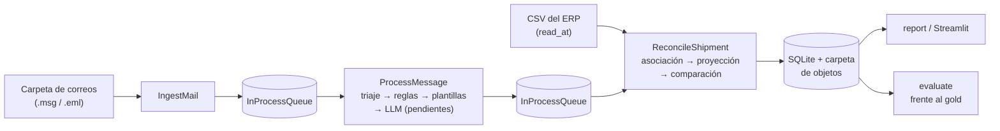

# Diseño de la PoC

| Campo | Valor |
|---|---|
| Versión | 0.1.4 |
| Estado | Borrador |
| Responsable | Pablo Iglesias Peral |
| Última actualización | 23/11/2026 |
| Tarea | F2.10 (#26) |
| Implementación | F3 (#29 a #38), evaluación en F4 (#39 a #44) |
| Decisiones relacionadas | [ADR-0004](adr/0004-formato-entrega-e-interfaz-poc.md) (CLI y Streamlit), [ADR-0005](adr/0005-llm-local-ollama-en-la-poc.md) (LLM local), [ADR-0007](adr/0007-monolito-modular-con-workers-por-etapa.md) a [ADR-0012](adr/0012-despliegue-en-contenedores-portables.md) |

> **Confidencialidad:** sin datos reales. La PoC procesa la muestra real solo en local, con las salidas en `data/output/` (ignorada por git); la demo pública y los tests usan datos sintéticos.

## 1. Objetivo

Demostrar, con código sencillo y funcional, que el diseño resuelve las cinco cosas que pide el enunciado: **extraer** los datos de los correos, **clasificarlos**, **asociarlos** al expediente, **cruzarlos con el ERP** y **detectar las discrepancias**, con trazabilidad hasta la cita del correo.

No pretende demostrar los objetivos de precisión de producción: con el gold standard disponible no es posible estadísticamente ([fiabilidad §6](07_fiabilidad.md#6-evaluación-en-la-poc-f4)).

**Principio:** la PoC es **el mismo código** que la arquitectura de producción, con adaptadores más simples. El dominio y los casos de uso no saben si corren en un portátil o en la nube; lo que cambia son los adaptadores.

## 2. Qué se implementa, qué se simplifica y qué se queda en el diseño

| Componente de la arquitectura | En la PoC | Cómo |
|---|---|---|
| Ingesta del buzón | 🟡 Simplificado | Lectura de una carpeta de `.msg` y `.eml` (`FolderMailSource`) en lugar de Microsoft Graph |
| Desempaquetado, limpieza y división del hilo | ✅ Implementado | Correos incrustados, firmas y avisos, división por cabeceras citadas, deduplicación por hash |
| Texto de los PDF | ✅ Implementado | Capa de texto del PDF |
| OCR | 🟡 Simplificado | Detecta y marca los PDF sin capa de texto; el OCR (Tesseract) solo si sobra tiempo (PLAN, revisión 1.10.0) |
| Triaje y prioridad | ✅ Implementado | Reglas en YAML |
| Clasificador | 🟡 Simplificado | Reglas y LLM; el clasificador clásico (TF-IDF + regresión logística) se queda en el diseño, porque con 38 correos no hay con qué entrenarlo |
| Extractores deterministas | ✅ Implementado | Identificadores, contenedores con ISO 6346, fechas con su precisión, UN/LOCODE y buques con un diccionario reducido |
| Plantillas | 🟡 Simplificado | Una o dos plantillas de PDF de booking frecuentes, en YAML |
| Extractor LLM | ✅ Implementado | Ollama en local, esquema JSON impuesto, temperatura 0, solo los campos pendientes y la cita verificada en el texto |
| Normalizador y validador | ✅ Implementado | Pydantic y reglas de dominio |
| Confianza | 🟡 Simplificado | Tabla de confianzas iniciales por escalón y señal ([fiabilidad §3.2](07_fiabilidad.md#32-modelo-de-calibración)); sin calibración aprendida |
| Asociación | ✅ Implementado | Orden booking → expediente → contenedor → B/L → referencias del hilo, con alias |
| Proyección del valor vigente | ✅ Implementado | Política del [ADR-0009](adr/0009-politica-de-resolucion-de-discrepancias.md) desde `config/reconciliation.yaml` |
| Lectura del ERP | ✅ Implementado | CSV con `read_at` (`CsvErpGateway`) |
| Comparación y veredictos | ✅ Implementado | Los siete veredictos, tolerancias, regla «ERP más reciente» y prioridades P1–P3 |
| Coherencia interna del ERP | ✅ Implementado | Reglas del ADR-0009 §5 |
| Persistencia | ✅ Implementado | SQLite con el esquema del [modelo de datos](05_modelo_datos.md), SQLAlchemy; carpeta local como almacén de objetos |
| Colas y workers | 🟡 Simplificado | Cola en proceso (`InProcessQueue`) detrás del puerto `TaskQueue`; las etapas se ejecutan en orden en un solo proceso |
| Revisión y correcciones | 🟡 Simplificado | Streamlit: vista del expediente, lista de discrepancias y corrección simple (PLAN, revisión 1.10.0) |
| Aprendizaje | 🟡 Simplificado | Corrección como observación humana, banco de ejemplos para el LLM y orden día-mes por remitente ([aprendizaje §8](08_aprendizaje_continuo.md#8-en-la-poc)) |
| Notificaciones | 🟡 Simplificado | `LogNotifier`: los avisos urgentes se escriben en el informe |
| Seguridad | 🟡 Simplificado | Todo local, sin servicios externos, logs sin contenido ([seguridad §9](09_seguridad.md#9-en-la-poc-prueba-técnica)) |
| Seudonimización antes del LLM | 📐 Diseño | No hace falta: el LLM es local |
| Auditoría por muestreo, recalibración, doble revisión | 📐 Diseño | Requiere volumen y operativos |
| Despliegue en la nube, alta disponibilidad, escalado | 📐 Diseño | ADR-0012; la PoC se ejecuta en local |
| API de las navieras, exportación al ERP | 📐 Diseño | RF-07, RF-64 |

## 3. Estructura del código

```text
src/eshipping_ai/
├── domain/                  # Sin dependencias externas (salvo Pydantic)
│   ├── model.py             # Mail, Message, Document, Shipment, Observation, FieldState, Verdict, Correction
│   ├── vocabulary.py        # Clases de correo, eventos DCSA, clasificadores, roles, veredictos (ADR-0006, ADR-0009)
│   ├── identifiers.py       # Contenedor ISO 6346, referencias, UN/LOCODE (validación y normalización)
│   ├── policy.py            # Autoridad por campo, proyección del valor vigente (ADR-0009 §1-§3)
│   ├── comparison.py        # Tolerancias, veredictos y prioridades (ADR-0009 §4-§6)
│   └── ports.py             # Clock, MailSource, ObjectStore, DocumentParser, LLMClient, ERPGateway, Repository, Notifier, TaskQueue
├── application/             # Casos de uso; solo dependen del dominio
│   ├── ingest.py            # IngestMail
│   ├── process.py           # ProcessMessage: triaje, clasificación, cascada de extracción
│   ├── reconcile.py         # ReconcileShipment
│   ├── review.py            # ApplyCorrection
│   └── evaluate.py          # Evaluate (frente a un gold standard)
├── extraction/              # Escalones de la cascada (puros, sin E/S)
│   ├── thread.py            # División del hilo, fecha de cada mensaje, limpieza y hash (F3.2)
│   ├── triage.py
│   ├── references.py        # Contenedores ISO 6346, bookings, expedientes y B/L, con su contexto (F3.3)
│   ├── dates.py             # Fechas con precisión, rangos, año inferido y orden día-mes (F3.3)
│   ├── locations.py         # Puertos y UN/LOCODE; tabla reducida de ejemplo (F3.3)
│   ├── equipment.py         # Número y tipo de contenedores a código ISO y TEU (F3.3)
│   ├── templates.py         # Plantillas YAML
│   ├── llm_extractor.py     # Prompt, esquema y verificación de la cita
│   └── confidence.py        # Tabla de confianzas iniciales
├── adapters/
│   ├── mail_files.py        # FolderMailSource y MailFileParser (.msg con extract-msg, .eml con la biblioteca estándar)
│   ├── pdf_text.py          # Texto de PDF con pypdf
│   ├── ollama_client.py     # OllamaClient (HTTP)
│   ├── fake_llm.py          # FakeLLMClient para los tests
│   ├── erp_csv.py           # CsvErpGateway
│   ├── sqlite_repository.py # SqlAlchemyRepository
│   ├── object_store.py      # Carpeta local con claves por hash
│   ├── queue_inprocess.py   # InProcessQueue
│   └── notifier_log.py      # LogNotifier
└── entrypoints/
    ├── cli.py               # eshipping ingest | process | report | evaluate
    └── streamlit_app.py     # Vista para operativos

config/                      # Configuración versionada (sin datos reales)
├── reconciliation.yaml      # Autoridad, tolerancias, prioridades (ADR-0009)
├── triage.yaml              # Palabras de urgencia y ruido
├── confidence.yaml          # Confianzas iniciales y umbrales por campo
├── senders.yaml             # Directorio de remitentes por dominio (sintético en el repo)
└── templates/               # Plantillas de documentos
```

La regla de dependencias se comprueba en la CI con `import-linter`: `domain` no importa `application`, `extraction` ni `adapters`; `application` y `extraction` no importan `adapters`.

## 4. Funcionamiento



- **Idempotente:** volver a ejecutar sobre la misma carpeta no duplica nada (claves del [modelo de datos §3](05_modelo_datos.md#3-capa-de-entrada-inmutable)).
- **Reproducible:** temperatura 0, esquema impuesto, versiones de modelo y de configuración registradas en cada observación.
- **Sin LLM:** con `--no-llm`, la cascada se detiene en las plantillas y lo pendiente va a revisión. Sirve para medir cuánto resuelve cada escalón y para ejecutar la demo sin Ollama.
- **Modo de evaluación:** `evaluate` compara el resultado con un gold standard (el real, en local, o el sintético) y escribe **solo métricas agregadas**, con intervalos de Wilson, porcentaje por escalón, tokens y latencia ([fiabilidad §2.3](07_fiabilidad.md#23-métricas)).

## 5. Interfaces

### 5.1 CLI

| Orden | Qué hace |
|---|---|
| `eshipping ingest <carpeta>` | Ingesta, desempaquetado, limpieza y división de los hilos |
| `eshipping process [--no-llm] [--model <nombre>]` | Clasificación y extracción de los mensajes pendientes |
| `eshipping reconcile --erp <csv>` | Lectura del ERP, asociación, proyección y veredictos |
| `eshipping run <carpeta> --erp <csv>` | Las tres anteriores en orden |
| `eshipping report [--shipment <id>] [--format md\|json]` | Expedientes, línea temporal, discrepancias por prioridad, con citas y reglas |
| `eshipping evaluate --gold <json>` | Métricas agregadas frente al gold standard |

Con `make demo` se ejecuta todo sobre los datos sintéticos.

### 5.2 Streamlit (alcance recortado)

1. **Lista de discrepancias**, por prioridad, con el veredicto, el valor del ERP y el propuesto.
2. **Vista del expediente:** campos con su valor vigente, la línea temporal de observaciones (planificado, estimado y real) y la cita y la fuente de cada una.
3. **Corrección simple:** aceptar, corregir o rechazar un valor; se guarda como observación humana y se vuelve a reconciliar el expediente.

## 6. LLM en la PoC

- **Ollama** en local, en un Mac M5 con 16 GB ([ADR-0005](adr/0005-llm-local-ollama-en-la-poc.md)).
- **Candidatos:** dos o tres modelos abiertos de 3 a 8B parámetros, cuantizados; se fijan y se comparan en F4.4b (D9, #43).
- **Una llamada por mensaje** con los campos pendientes; prompt con prefijo fijo (instrucciones y esquema) y el mensaje nuevo limpio; salida con esquema JSON por campo: valor, clasificador, cita literal.
- **Validación:** la cita tiene que aparecer en el texto; si no, el valor se descarta y se cuenta como cita no verificada.
- **Banco de ejemplos:** las correcciones validadas del mismo remitente se añaden como ejemplos (hasta tres).
- **Puerto `LLMClient`:** cambiar a un proveedor de la lista del [ADR-0010](adr/0010-proveedor-de-llm-de-produccion.md) es un adaptador nuevo, sin tocar el resto.

## 7. Datos sintéticos (F3.10)

- **Qué contienen:** unos cuatro expedientes inventados (empresas, buques, puertos reales del UN/LOCODE, bookings y contenedores con dígito de control válido), con hilos que cubren:
  - reenvíos con correos incrustados y mensajes citados;
  - un roleo con cambio de buque y de booking;
  - una fecha estimada que pasa a real;
  - una fecha ambigua (día-mes) y un correo de ruido;
  - un correo con instrucciones maliciosas para el LLM ([seguridad §6](09_seguridad.md#6-amenazas-propias-del-sistema)).
- **El ERP sintético** tiene las columnas relevantes para el cruce ([análisis §3.2](01_analisis_datos.md#32-columnas-relevantes-para-el-cruce)) y el mismo formato que el real (BOM, `;`, `dd/mm/aaaa`, coma decimal, espacios sobrantes), con valores inventados y discrepancias sembradas para que aparezcan los siete veredictos.
- **Gold standard sintético** con el resultado esperado, en el mismo formato que el real.
- **Cómo se guardan:** el hook de confidencialidad bloquea cualquier `.eml` o `.csv`, también en `data_sample/`, y no se debilita. Por eso los datos sintéticos se versionan como una **especificación en YAML** (`data_sample/spec/`) y un generador (`make sample`) crea los `.eml`, el CSV y el gold en `data_sample/build/`, que está ignorado por git. Los tests usan el mismo generador (`eshipping_ai.synthetic`), cuya salida es determinista.

**Implementado (F3.10):** `data_sample/spec/sample.yaml` con cuatro expedientes y un correo de ruido:

| Expediente | Escenario | Veredictos que siembra |
|---|---|---|
| ES26900001 | Camino feliz; levante solo en los correos | `MATCH`, `ERP_MISSING`, `NOT_IN_ERP` |
| ES26900002 | Roleo con cambio de buque y booking nuevo (alias); reenvío interno que cita el aviso de la naviera | `DISCREPANCY`, `MAIL_MISSING`, `MATCH` por alias |
| ES26900003 | Salida real con errata día-mes en el ERP; carga en un rango; ETA del cliente (rango C) con fecha ambigua | `ERP_ERROR`, `MATCH` por rango, `MAIL_MISSING` |
| ES26900004 | El ERP marca la salida como real después del último correo; llegada vacía en el ERP; correo con instrucciones maliciosas | `ERP_NEWER`, `ERP_MISSING` |
| Ruido | Boletín sin relación con ningún expediente | Clase `OTR` |

## 8. Pruebas y calidad

| Nivel | Qué | Con qué |
|---|---|---|
| Unitarias | Dominio (identificadores, política, comparación, veredictos), extractores, limpieza y división de hilos | Casos sintéticos en el código del test |
| Contrato | Cada adaptador cumple su puerto | El mismo conjunto de tests para `FakeLLMClient` y `OllamaClient` (este último, solo si Ollama está disponible) |
| Integración | `run` de extremo a extremo sobre los datos sintéticos, con `FakeLLMClient` | Comparación con el gold sintético |
| Regresión | Casos límite: fechas ambiguas, roleo, `ERP_NEWER`, inyección de instrucciones | Datos sintéticos |
| Arquitectura | Regla de dependencias | `import-linter` en la CI |

- **Cobertura mínima:** 90 % en `domain` y `extraction`; la CI falla por debajo.
- **CI:** ruff, mypy estricto, pytest e `import-linter`; sin Ollama en la CI (se usa `FakeLLMClient`).
- **Dependencias** de ejecución fijadas con su versión al añadirse: `pydantic`, `sqlalchemy`, `extract-msg`, `pdfplumber`, `pyyaml`, `typer`, `httpx` y `streamlit` (grupo opcional `ui`).

## 9. Orden de implementación (martes 24/11)

| Orden | Tarea | Issue | Resultado |
|---|---|---|---|
| 1 | Dominio, puertos y `import-linter` | #29 | Modelo y políticas probados |
| 2 | Datos sintéticos (especificación y generador) | #38 | Base para todos los tests |
| 3 | Ingesta, limpieza y división de hilos, texto de PDF | #30 | Mensajes deduplicados |
| 4 | Extractores deterministas y triaje | #31 | Primer escalón de la cascada |
| 5 | ERP en CSV y reconciliación | #34 | Veredictos sin LLM |
| 6 | Persistencia SQLite | #35 | Linaje y reproceso |
| 7 | CLI y `make demo` | #36 | Demo de extremo a extremo con `--no-llm` |
| 8 | Puerto `LLMClient`, Ollama y validación de citas | #32 | Campos de texto libre |
| 9 | Asociación con alias y casos de roleo | #33 | Asociación completa |
| 10 | Streamlit reducido | #37 | Vista para operativos |

El orden pone primero lo que hace funcionar el sistema de extremo a extremo sin LLM: si falta tiempo, la PoC ya demuestra la extracción determinista, la asociación y la reconciliación, y el LLM se añade como un escalón más.

**Si falta tiempo, se recorta por este orden:** OCR, Streamlit (el informe de la CLI cubre la vista del expediente), plantillas de PDF y banco de ejemplos. No se recortan los tests, la regla de dependencias ni la validación de las citas.

## 10. Trazabilidad con el enunciado

| Lo que pide el enunciado | Dónde lo demuestra la PoC |
|---|---|
| Extraer información de los correos | `process`: cascada con reglas, plantillas y LLM, con citas |
| Clasificar los correos | Triaje y clasificador (reglas y LLM) |
| Asociar al expediente | `reconcile`: asociación por identificadores con alias |
| Cruzar con el ERP | `CsvErpGateway` y comparación por campo |
| Detectar discrepancias | Siete veredictos con regla, fuente y prioridad; informe y Streamlit |
| Admitir correos nuevos | `eshipping run <carpeta>` sobre cualquier carpeta de `.msg` o `.eml` |

## Historial

| Versión | Fecha | Cambios |
|---|---|---|
| 0.1.4 | 24/11/2026 | Extractores deterministas implementados (F3.3): `references.py`, `dates.py`, `locations.py` y `equipment.py` en lugar de un único `rules.py`; el triaje queda para el caso de uso de procesado |
| 0.1.3 | 24/11/2026 | Ingesta implementada (F3.2): `thread.py` y `mail_files.py`; el cuerpo de un correo contenedor no cuenta como mensaje |
| 0.1.2 | 24/11/2026 | §7: datos sintéticos implementados (cuatro expedientes y ruido) y formato del ERP sintético |
| 0.1.1 | 24/11/2026 | Estructura del dominio tal como se implementa en F3.1: `vocabulary.py` en lugar de `events.py`, y puertos `Clock` y `ObjectStore` |
| 0.1.0 | 23/11/2026 | Primera versión: alcance por componente, estructura del código, funcionamiento, CLI y Streamlit, LLM local, datos sintéticos generados desde YAML, pruebas y orden de implementación |
