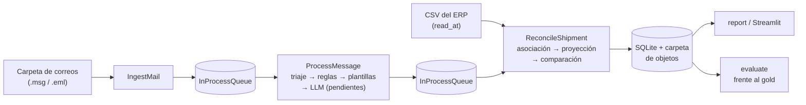

# Diseño de la PoC

| Campo | Valor |
|---|---|
| Versión | 0.2.3 |
| Estado | Entregado (`v1.0.0`) |
| Responsable | Pablo Iglesias Peral |
| Última actualización | 23/11/2026 |
| Tarea | F2.10 (#26) |
| Implementación | F3 (#29 a #38), evaluación en F4 (#39 a #44) |
| Decisiones relacionadas | [ADR-0004](adr/0004-formato-entrega-e-interfaz-poc.md) (CLI y Streamlit), [ADR-0005](adr/0005-llm-local-ollama-en-la-poc.md) (LLM local), [ADR-0007](adr/0007-monolito-modular-con-workers-por-etapa.md) a [ADR-0012](adr/0012-despliegue-en-contenedores-portables.md) |

> **Confidencialidad:** sin datos reales. La PoC procesa la muestra real solo en local, con las salidas en `data/output/` (ignorada por git); la demo pública y los tests usan datos sintéticos.

## 1. Objetivo

Demostrar, con código sencillo y funcional, que el diseño resuelve las cinco cosas que pide el enunciado: **extraer** los datos de los correos, **clasificarlos**, **asociarlos** al expediente, **cruzarlos con el ERP** y **detectar las discrepancias**, con trazabilidad hasta la cita del correo.

No pretende demostrar los objetivos de precisión de producción: con el gold standard disponible no es posible estadísticamente ([fiabilidad §6](07_fiabilidad.md#6-evaluación-en-la-poc-f4)).

**Principio:** la PoC es **el mismo código** que la arquitectura de producción, con adaptadores más simples. El dominio y los casos de uso no saben si corren en un portátil o en la nube; lo que cambia son los adaptadores.

## 2. Qué se implementa, qué se simplifica y qué se queda en el diseño

| Componente de la arquitectura | En la PoC | Cómo |
|---|---|---|
| Ingesta del buzón | 🟡 Simplificado | Lectura de una carpeta de `.msg` y `.eml` (`FolderMailSource`) en lugar de Microsoft Graph |
| Desempaquetado, limpieza y división del hilo | ✅ Implementado | Correos incrustados, firmas y avisos, división por cabeceras citadas, deduplicación por hash |
| Texto de los PDF | ✅ Implementado | Capa de texto del PDF |
| OCR | 🟡 Simplificado | Detecta y marca los PDF sin capa de texto; el OCR (Tesseract) solo si sobra tiempo (PLAN, revisión 1.10.0) |
| Triaje y prioridad | ✅ Implementado | Reglas en YAML |
| Clasificador | 🟡 Simplificado | Reglas y LLM; el clasificador clásico (TF-IDF + regresión logística) se queda en el diseño, porque con 38 correos no hay con qué entrenarlo |
| Extractores deterministas | ✅ Implementado | Identificadores, contenedores con ISO 6346, fechas con su precisión, UN/LOCODE y buques con un diccionario reducido |
| Plantillas | 🟡 Simplificado | Una o dos plantillas de PDF de booking frecuentes, en YAML |
| Extractor LLM | ✅ Implementado | Ollama en local, esquema JSON impuesto (o en las instrucciones si el modelo no lo admite), temperatura 0, solo los campos pendientes y con pista en el texto, y cita verificada en el texto (`extraction/llm_extractor.py`) |
| Normalizador y validador | ✅ Implementado | Pydantic y reglas de dominio |
| Confianza | 🟡 Simplificado | Tabla de confianzas iniciales por escalón y señal ([fiabilidad §3.2](07_fiabilidad.md#32-modelo-de-calibración)); sin calibración aprendida |
| Asociación | ✅ Implementado | Por los identificadores de todo el hilo, del más fuerte al más débil: expediente, booking (vigente o sustituido), B/L y contenedor. Un identificador de varios expedientes va a revisión; un expediente seguro enseña al índice los bookings y contenedores nuevos (`application/associate.py`) |
| Proyección del valor vigente | ✅ Implementado | Política del [ADR-0009](adr/0009-politica-de-resolucion-de-discrepancias.md) desde `config/reconciliation.yaml` |
| Lectura del ERP | ✅ Implementado | CSV con `read_at` (`CsvErpGateway`) |
| Comparación y veredictos | ✅ Implementado | Los siete veredictos, tolerancias, regla «ERP más reciente» y prioridades P1–P3 |
| Coherencia interna del ERP | ✅ Implementado | Reglas del ADR-0009 §5 |
| Persistencia | ✅ Implementado | SQLite con el esquema del [modelo de datos](05_modelo_datos.md), SQLAlchemy; carpeta local como almacén de objetos |
| Colas y workers | 🟡 Simplificado | Cola en proceso (`InProcessQueue`) detrás del puerto `TaskQueue`; las etapas se ejecutan en orden en un solo proceso |
| Revisión y correcciones | 🟡 Simplificado | Streamlit (`make ui`): lista de discrepancias, vista del expediente con línea temporal y corrección simple como observación humana (`application/review.py`); sin cola de tareas ni doble revisión |
| Aprendizaje | 🟡 Simplificado | Corrección como observación humana, banco de ejemplos para el LLM y orden día-mes por remitente ([aprendizaje §8](08_aprendizaje_continuo.md#8-en-la-poc)) |
| Notificaciones | 🟡 Simplificado | `LogNotifier`: los avisos urgentes se escriben en el informe |
| Seguridad | 🟡 Simplificado | Todo local, sin servicios externos, logs sin contenido ([seguridad §9](09_seguridad.md#9-en-la-poc-prueba-técnica)) |
| Seudonimización antes del LLM | 📐 Diseño | No hace falta: el LLM es local |
| Auditoría por muestreo, recalibración, doble revisión | 📐 Diseño | Requiere volumen y operativos |
| Despliegue en la nube, alta disponibilidad, escalado | 📐 Diseño | ADR-0012; la PoC se ejecuta en local |
| API de las navieras, exportación al ERP | 📐 Diseño | RF-07, RF-64 |

## 3. Estructura del código

```text
src/eshipping_ai/
├── domain/                  # Sin dependencias externas (salvo Pydantic)
│   ├── model.py             # Mail, Message, Document, Shipment, Observation, FieldState, Verdict, Correction
│   ├── vocabulary.py        # Clases de correo, eventos DCSA, clasificadores, roles, veredictos (ADR-0006, ADR-0009)
│   ├── identifiers.py       # Contenedor ISO 6346, referencias, UN/LOCODE (validación y normalización)
│   ├── policy.py            # Configuración, rango de cada fuente y valor vigente de un campo (ADR-0009 §1-§3)
│   ├── comparison.py        # Tolerancias, reglas A y B, coherencia del ERP, veredictos y prioridades (ADR-0009 §4-§6)
│   ├── senders.py           # Rol del remitente en cascada y orden día-mes (RF-73, ADR-0013)
│   └── ports.py             # Clock, MailSource, ObjectStore, DocumentParser, LLMClient, ERPGateway, Repository, Notifier, TaskQueue
├── application/             # Casos de uso; solo dependen del dominio
│   ├── ingest.py            # IngestMail
│   ├── associate.py         # Asociación del hilo con alias y aprendizaje de alias nuevos (F3.5)
│   ├── seed.py              # Siembra del índice de alias con el ERP (F3.5)
│   ├── process.py           # ProcessMessages: clasifica, asocia y extrae las observaciones de cada hilo (F3.5)
│   ├── reconcile.py         # ReconcileShipment
│   ├── report.py            # Vista del expediente: valor, veredicto, regla y cita (F3.8)
│   ├── review.py            # ApplyCorrection: aceptar, corregir o rechazar como observación (F3.9)
│   └── evaluate.py          # Acierto del veredicto frente a un gold standard (F3.8; F4 lo amplía)
├── extraction/              # Escalones de la cascada (puros, sin E/S)
│   ├── thread.py            # División del hilo, fecha de cada mensaje, limpieza y hash (F3.2)
│   ├── classify.py          # Clasificación por reglas y triaje: carril urgente y ruido (F3.5)
│   ├── events.py            # De hallazgos a candidatos de observación: campo, estado PLN/EST/ACT y evidencia (F3.5)
│   ├── references.py        # Contenedores ISO 6346, bookings, expedientes y B/L, con su contexto (F3.3)
│   ├── dates.py             # Fechas con precisión, rangos, año inferido y orden día-mes (F3.3)
│   ├── locations.py         # Puertos y UN/LOCODE; tabla reducida de ejemplo (F3.3)
│   ├── equipment.py         # Número y tipo de contenedores a código ISO y TEU (F3.3)
│   ├── templates.py         # Plantillas YAML
│   ├── llm_extractor.py     # Campos pendientes, prompt, esquema y verificación de la cita (F3.4)
│   └── confidence.py        # Tabla de confianzas iniciales
├── adapters/
│   ├── mail_files.py        # FolderMailSource y MailFileParser (.msg con extract-msg, .eml con la biblioteca estándar)
│   ├── pdf_text.py          # Texto de PDF con pypdf
│   ├── ollama_client.py     # OllamaClient (HTTP, biblioteca estándar; esquema impuesto o en las instrucciones)
│   ├── fake_llm.py          # FakeLLMClient para los tests
│   ├── erp_csv.py           # CsvErpGateway (lectura del CSV y normalización)
│   ├── config_yaml.py       # Carga de config/reconciliation.yaml
│   ├── sql_schema.py        # Esquema relacional portable SQLite/PostgreSQL (F3.7)
│   ├── sql_repository.py    # SqlRepository: todos los almacenes del dominio sobre SQLAlchemy
│   ├── object_store.py      # Carpeta local con claves por hash
│   ├── clock.py             # SystemClock y FixedClock (F3.8)
│   ├── log_notifier.py      # LogNotifier: avisos urgentes al log sin contenido (F3.8)
│   ├── queue_inprocess.py   # InProcessQueue
│   └── notifier_log.py      # LogNotifier
└── entrypoints/
    ├── cli.py               # eshipping ingest | process | reconcile | run | report | evaluate (F3.8)
    └── streamlit_app.py     # Vista para operativos: discrepancias, expediente y corrección (F3.9)

config/                      # Configuración versionada (sin datos reales)
├── reconciliation.yaml      # Autoridad, tolerancias, prioridades (ADR-0009)
├── triage.yaml              # Palabras de urgencia y ruido
├── confidence.yaml          # Confianzas iniciales y umbrales por campo
├── senders.yaml             # Dominios curados (propios y navieras) y partes del ERP (ADR-0013)
└── templates/               # Plantillas de documentos
```

La regla de dependencias se comprueba en la CI con `import-linter`: `domain` no importa `application`, `extraction` ni `adapters`; `application` y `extraction` no importan `adapters`.

## 4. Funcionamiento



- **Idempotente:** volver a ejecutar sobre la misma carpeta no duplica nada (claves del [modelo de datos §3](05_modelo_datos.md#3-capa-de-entrada-inmutable)).
- **Reproducible:** temperatura 0, esquema impuesto, versiones de modelo y de configuración registradas en cada observación.
- **Sin LLM:** con `--no-llm`, la cascada se detiene en las plantillas y lo pendiente va a revisión. Sirve para medir cuánto resuelve cada escalón y para ejecutar la demo sin Ollama.
- **Modo de evaluación:** `evaluate` compara el resultado con un gold standard (el real, en local, o el sintético) y escribe **solo métricas agregadas**, con intervalos de Wilson, porcentaje por escalón, tokens y latencia ([fiabilidad §2.3](07_fiabilidad.md#23-métricas)).

## 5. Interfaces

### 5.1 CLI

| Orden | Qué hace |
|---|---|
| `eshipping ingest <carpeta>` | Ingesta, desempaquetado, limpieza y división de los hilos |
| `eshipping process --erp <csv> [--senders <yaml>]` | Siembra del índice de alias con el ERP, clasificación, asociación y extracción de los mensajes pendientes |
| `eshipping reconcile --erp <csv>` | Lectura del ERP, proyección del valor vigente, veredictos y avisos urgentes |
| `eshipping run <carpeta> --erp <csv>` | Las tres anteriores en orden |
| `eshipping report [--shipment <id>] [--format md\|json]` | Campos de cada expediente, lo urgente primero, con valor de los correos, valor del ERP, veredicto, regla y cita |
| `eshipping evaluate --gold <json> [--verbose]` | Acierto del veredicto por campo frente al gold standard (F4 añade precisión y cobertura por campo) |

Opciones comunes: `--workdir` (base de datos y almacén de objetos; `data/output/` por defecto, ignorado por git), `--config`, `--tz` y `--now`, que fija el reloj y el momento de lectura del ERP para repetir un día. `ESHIPPING_DATABASE_URL` cambia la base de datos sin tocar nada más. `process` y `run` aceptan `--no-llm`, `--model` y `--ollama-url` (o `OLLAMA_HOST`).

Con `make demo` se ejecuta todo sobre los datos sintéticos sin LLM, con el reloj del 07/10/2026 a las 08:00, y se evalúa frente a su gold; `make demo-llm MODEL=<modelo>` hace lo mismo con el escalón del LLM.

### 5.2 Streamlit (alcance recortado)

1. **Lista de discrepancias**, por prioridad, con el veredicto, el valor del ERP y el propuesto.
2. **Vista del expediente:** campos con su valor vigente, la línea temporal de observaciones (planificado, estimado y real) y la cita y la fuente de cada una.
3. **Corrección simple:** aceptar, corregir o rechazar un valor; se guarda como observación humana y se vuelve a reconciliar el expediente.

Una decisión nunca edita lo que dijo una fuente: aceptar o corregir añade una observación humana (rol `human_review`, rango A, que gana por la política), y rechazar marca como sustituida la observación que sostenía el valor, de modo que pasa a mandar la siguiente. La observación humana no tiene correo detrás: su fuente es la propia corrección (`correction:<id>`) y su evidencia, el motivo del operativo. Se arranca con `make ui` sobre la base de la demo; `ESHIPPING_WORKDIR`, `ESHIPPING_ERP` y `ESHIPPING_NOW` la apuntan a otra. Streamlit es un extra opcional (`pip install -e '.[ui]'`): la CLI no lo necesita.

## 6. LLM en la PoC

- **Ollama** en local, en un Mac M5 con 16 GB ([ADR-0005](adr/0005-llm-local-ollama-en-la-poc.md)).
- **Modelo:** `qwen3.5:4b`, elegido en F4.4b entre tres modelos abiertos de 3 a 8B parámetros, cuantizados ([ADR-0015](adr/0015-modelo-local-de-la-poc.md); comparativa en la [evaluación §5.8](11_evaluacion.md#58-comparativa-de-modelos-locales-f44b)).
- **Una llamada por mensaje** con los campos pendientes: los que la clase del mensaje hace esperables, que las reglas no han encontrado y de los que el texto tiene alguna pista (una confirmación de booking sin una palabra sobre cut-offs no los pregunta). Prompt con prefijo fijo (instrucciones y esquema) y el mensaje nuevo limpio, hasta 12.000 caracteres; salida con esquema JSON por hecho: campo, valor, clasificador y cita literal.
- **Esquema impuesto o en las instrucciones:** con Ollama 0.40, `llama3.2:3b` admite el esquema en `format`; `qwen3.5:4b` y `gemma4:e4b` responden 501 y el adaptador pasa a poner el esquema en las instrucciones y a extraer el objeto JSON de la respuesta. La validación es la misma en los dos casos.
- **Validación determinista** (nada de la respuesta se da por bueno):
  - la cita tiene que estar en el texto (solo se toleran cambios de espacios y mayúsculas);
  - el valor sale de la cita: una fecha escrita en ella, con al menos dos palabras de contexto, y sin que el vocabulario de las reglas atribuya la cita a otro campo (una «ETD» no puede ser una llegada); un buque que aparece en ella; un número de contenedores que es uno de sus números;
  - una fecha plausible para la fecha del mensaje (de −60 a +180 días);
  - lo que falla se descarta y se cuenta por motivo (`llm_rejected`).
- **Confianza fija por escalón** (0,85, zona de revisión): nunca es la que declara el modelo. El estado PLN/EST/ACT del modelo solo vale para fechas; un nombre de buque o un número de contenedores es una estimación, como en las reglas, y un buque citado junto a un roleo es un cambio de buque.
- **Inyección de instrucciones:** el correo malicioso sintético llega al LLM (su asunto dice «booking»). Si el modelo obedece, la cita atribuye la fecha a otro campo y se descarta; y aunque pasara, el remitente es desconocido, su autoridad es la mínima y el valor queda pendiente de confirmación. Lo prueban los tests con un modelo falso que obedece.
- **Sin modelo:** con `--no-llm` (o si Ollama no responde y se usa esa opción) la cascada se detiene en las reglas; sin la opción, la CLI se niega a empezar si Ollama no tiene el modelo, en lugar de procesar a medias. El modelo por defecto es `qwen3.5:4b`, elegido por benchmark en F4.4b ([ADR-0015](adr/0015-modelo-local-de-la-poc.md)).
- **Banco de ejemplos:** las correcciones validadas del mismo remitente se añaden como ejemplos (hasta tres).
- **Puerto `LLMClient`:** cambiar a un proveedor de la lista del [ADR-0010](adr/0010-proveedor-de-llm-de-produccion.md) es un adaptador nuevo, sin tocar el resto.

## 7. Datos sintéticos (F3.10)

- **Qué contienen:** unos cuatro expedientes inventados (empresas, buques, puertos reales del UN/LOCODE, bookings y contenedores con dígito de control válido), con hilos que cubren:
  - reenvíos con correos incrustados y mensajes citados;
  - un roleo con cambio de buque y de booking;
  - una fecha estimada que pasa a real;
  - una fecha ambigua (día-mes) y un correo de ruido;
  - un correo con instrucciones maliciosas para el LLM ([seguridad §6](09_seguridad.md#6-amenazas-propias-del-sistema)).
- **El ERP sintético** tiene las columnas relevantes para el cruce ([análisis §3.2](01_analisis_datos.md#32-columnas-relevantes-para-el-cruce)) y el mismo formato que el real (BOM, `;`, `dd/mm/aaaa`, coma decimal, espacios sobrantes), con valores inventados y discrepancias sembradas para que aparezcan los siete veredictos.
- **Gold standard sintético** con el resultado esperado, en el mismo formato que el real.
- **Cómo se guardan:** el hook de confidencialidad bloquea cualquier `.eml` o `.csv`, también en `data_sample/`, y no se debilita. Por eso los datos sintéticos se versionan como una **especificación en YAML** (`data_sample/spec/`) y un generador (`make sample`) crea los `.eml`, el CSV y el gold en `data_sample/build/`, que está ignorado por git. Los tests usan el mismo generador (`eshipping_ai.synthetic`), cuya salida es determinista.

**Implementado (F3.10):** `data_sample/spec/sample.yaml` con cuatro expedientes y un correo de ruido:

| Expediente | Escenario | Veredictos que siembra |
|---|---|---|
| ES26900001 | Camino feliz; levante solo en los correos | `MATCH`, `ERP_MISSING`, `NOT_IN_ERP` |
| ES26900002 | Roleo con cambio de buque y booking nuevo (alias); reenvío interno que cita el aviso de la naviera | `DISCREPANCY`, `MAIL_MISSING`, `MATCH` por alias |
| ES26900003 | Salida real con errata día-mes en el ERP; carga en un rango; ETA del cliente (rango C) con fecha ambigua | `ERP_ERROR`, `MATCH` por rango, `MAIL_MISSING` |
| ES26900004 | El ERP marca la salida como real después del último correo; llegada vacía en el ERP; correo con instrucciones maliciosas | `ERP_NEWER`, `ERP_MISSING` |
| Ruido | Boletín sin relación con ningún expediente | Clase `OTR` |

## 8. Pruebas y calidad

| Nivel | Qué | Con qué |
|---|---|---|
| Unitarias | Dominio (identificadores, política, comparación, veredictos), extractores, limpieza y división de hilos | Casos sintéticos en el código del test |
| Contrato | Cada adaptador cumple su puerto | El mismo conjunto de tests para `FakeLLMClient` y `OllamaClient` (este último, solo si Ollama está disponible) |
| Propiedades | Con cualquier texto los extractores no fallan, toda mención apunta a los caracteres exactos que cita, el dígito de control ISO 6346 detecta cualquier error de un dígito y una fecha completa se lee tal como está escrita | Hypothesis (`HYPOTHESIS_PROFILE=thorough` para 5.000 ejemplos por propiedad) |
| Integración | `run` de extremo a extremo sobre los datos sintéticos, con `FakeLLMClient`, SQLite real y la vista de Streamlit (`AppTest`); ficheros rotos en la carpeta no cambian el resultado | Comparación con el gold sintético. Marcador `integration`: lo lleva solo todo test que usa el conjunto sintético generado (`make test-integration`; `make test-unit` para el resto) |
| Regresión | Casos límite: fechas ambiguas, roleo, `ERP_NEWER`, inyección de instrucciones | Datos sintéticos |
| Arquitectura | Regla de dependencias | `import-linter` en la CI |

- **Cobertura mínima:** 90 % en todo el paquete (`fail_under`); la CI falla por debajo. En el cierre de F4.1, `domain` está al 100 % y `extraction` por encima del 95 %. La página de Streamlit queda fuera de la medida porque Streamlit la ejecuta por su cuenta; se prueba con `AppTest`.
- **CI:** ruff, mypy estricto, pytest e `import-linter`; sin Ollama en la CI (se usa `FakeLLMClient`).
- **Dependencias** de ejecución fijadas con su versión al añadirse: `pydantic`, `sqlalchemy`, `alembic`, `extract-msg`, `pypdf`, `pyyaml` y `streamlit` (grupo opcional `ui`). La CLI usa `argparse` y el cliente de Ollama, `urllib`, ambos de la biblioteca estándar. De desarrollo, además de las herramientas de calidad, `hypothesis` para los tests de propiedades.

## 9. Orden de implementación (martes 24/11)

| Orden | Tarea | Issue | Resultado |
|---|---|---|---|
| 1 | Dominio, puertos y `import-linter` | #29 | Modelo y políticas probados |
| 2 | Datos sintéticos (especificación y generador) | #38 | Base para todos los tests |
| 3 | Ingesta, limpieza y división de hilos, texto de PDF | #30 | Mensajes deduplicados |
| 4 | Extractores deterministas y triaje | #31 | Primer escalón de la cascada |
| 5 | ERP en CSV y reconciliación | #34 | Veredictos sin LLM |
| 6 | Persistencia SQLite | #35 | Linaje y reproceso |
| 7 | CLI y `make demo` | #36 | Demo de extremo a extremo con `--no-llm` |
| 8 | Puerto `LLMClient`, Ollama y validación de citas | #32 | Campos de texto libre |
| 9 | Asociación con alias y casos de roleo | #33 | Asociación completa |
| 10 | Streamlit reducido | #37 | Vista para operativos |

El orden pone primero lo que hace funcionar el sistema de extremo a extremo sin LLM: si falta tiempo, la PoC ya demuestra la extracción determinista, la asociación y la reconciliación, y el LLM se añade como un escalón más.

**Si falta tiempo, se recorta por este orden:** OCR, Streamlit (el informe de la CLI cubre la vista del expediente), plantillas de PDF y banco de ejemplos. No se recortan los tests, la regla de dependencias ni la validación de las citas.

## 10. Trazabilidad con el enunciado

| Lo que pide el enunciado | Dónde lo demuestra la PoC |
|---|---|
| Extraer información de los correos | `process`: cascada con reglas, plantillas y LLM, con citas |
| Clasificar los correos | Triaje y clasificador (reglas y LLM) |
| Asociar al expediente | `reconcile`: asociación por identificadores con alias |
| Cruzar con el ERP | `CsvErpGateway` y comparación por campo |
| Detectar discrepancias | Siete veredictos con regla, fuente y prioridad; informe y Streamlit |
| Admitir correos nuevos | `eshipping run <carpeta>` sobre cualquier carpeta de `.msg` o `.eml` |

## Historial

| Versión | Fecha | Cambios |
|---|---|---|
| 0.2.3 | 25/11/2026 | Coherencia con ADR-0013 y ADR-0015 (F5.2) |
| 0.2.2 | 25/11/2026 | Modelo local por defecto: `qwen3.5:4b` (ADR-0015) |
| 0.2.1 | 24/11/2026 | Streamlit reducido implementado (F3.9): tres pestañas, correcciones como observaciones humanas o sustituciones (nunca ediciones) y nueva reconciliación del expediente; Streamlit como extra opcional |
| 0.2.0 | 24/11/2026 | Escalón del LLM implementado (F3.4): campos pendientes con pista en el texto, validación determinista de la cita y del valor, confianza fija por escalón, esquema en las instrucciones para los modelos que no admiten `format`, modelo por defecto `llama3.2:3b` (provisional, D9) y `make demo-llm` |
| 0.1.9 | 24/11/2026 | CLI implementada (F3.8): `process` y `reconcile` reciben el ERP (la asociación necesita el índice sembrado antes de procesar), opciones comunes `--workdir` y `--now`, `--no-llm` se pospone al escalón del LLM y `make demo` |
| 0.1.8 | 24/11/2026 | Asociación con alias y `ProcessMessages` implementados (F3.5, parte 2): directorio de remitentes (`config/senders.yaml`) en el dominio, índice de alias sembrado con el ERP y ampliado con lo que enseñan los hilos, y tablas `classification` y `association` (migración 0002). La evidencia de una observación apunta al texto que leen las reglas (`Asunto: …` + cuerpo, o el texto del adjunto) |
| 0.1.7 | 24/11/2026 | Reglas de extracción implementadas (F3.5, parte 1): `classify.py` y `events.py` en lugar de `triage.py` y `rules.py`; el ruido se decide con el contexto del hilo |
| 0.1.6 | 24/11/2026 | Persistencia implementada (F3.7): `sql_schema.py` y `sql_repository.py`, migraciones de Alembic en `migrations/` |
| 0.1.5 | 24/11/2026 | Reconciliación implementada (F3.6): política de discrepancias, comparación con el ERP, adaptador del CSV y `config/reconciliation.yaml` |
| 0.1.4 | 24/11/2026 | Extractores deterministas implementados (F3.3): `references.py`, `dates.py`, `locations.py` y `equipment.py` en lugar de un único `rules.py`; el triaje queda para el caso de uso de procesado |
| 0.1.3 | 24/11/2026 | Ingesta implementada (F3.2): `thread.py` y `mail_files.py`; el cuerpo de un correo contenedor no cuenta como mensaje |
| 0.1.2 | 24/11/2026 | §7: datos sintéticos implementados (cuatro expedientes y ruido) y formato del ERP sintético |
| 0.1.1 | 24/11/2026 | Estructura del dominio tal como se implementa en F3.1: `vocabulary.py` en lugar de `events.py`, y puertos `Clock` y `ObjectStore` |
| 0.1.0 | 23/11/2026 | Primera versión: alcance por componente, estructura del código, funcionamiento, CLI y Streamlit, LLM local, datos sintéticos generados desde YAML, pruebas y orden de implementación |
