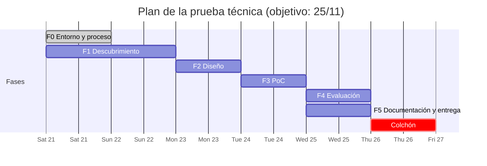

# Plan de actuación — Prueba técnica Ingeniero IA (EShipping)

| Campo | Valor |
|---|---|
| Versión | 1.1.0 |
| Estado | Borrador para revisión |
| Responsable | Pablo Iglesias Peral |
| Última actualización | 21/11/2026 |
| Documentos relacionados | [Índice de ADR](adr/README.md) · [CHANGELOG](../CHANGELOG.md) · [Índice de documentación](README.md) |

> Documento vivo. Cada cambio se registra en el [historial de revisiones](#15-historial-de-revisiones) y cada decisión relevante en un [ADR](adr/README.md). No contiene datos reales.

---

## Índice

1. [Objetivo](#1-objetivo)
2. [Alcance](#2-alcance)
3. [Principios de trabajo](#3-principios-de-trabajo)
4. [Calendario e hitos](#4-calendario-e-hitos)
5. [Fases en detalle](#5-fases-en-detalle)
6. [Estándares de ingeniería de software](#6-estándares-de-ingeniería-de-software)
7. [Estándares de arquitectura](#7-estándares-de-arquitectura)
8. [Estándares de documentación](#8-estándares-de-documentación)
9. [Flujo de trabajo en Git y GitHub](#9-flujo-de-trabajo-en-git-y-github)
10. [Gestión de la calidad](#10-gestión-de-la-calidad)
11. [Seguridad y confidencialidad](#11-seguridad-y-confidencialidad)
12. [Riesgos](#12-riesgos)
13. [Trazabilidad con el enunciado](#13-trazabilidad-con-el-enunciado)
14. [Registro de decisiones](#14-registro-de-decisiones)
15. [Historial de revisiones](#15-historial-de-revisiones)

---

## 1. Objetivo

Diseñar un sistema capaz de procesar más de 100.000 correos operativos de transporte marítimo que:

1. reciba e ingiera los correos,
2. los clasifique por tipo de evento,
3. extraiga los datos relevantes,
4. los normalice y los asocie al expediente,
5. los cruce con el ERP (DEIWORLD) y resuelva las discrepancias,
6. almacene el resultado y genere datos útiles para el negocio,
7. aprenda de forma continua de los operativos y de la relación con clientes y proveedores.

Este diseño se valida con una **prueba de concepto (PoC) funcional** sobre los correos y el CSV de muestra.

**Prioridad:** la calidad del planteamiento y la solidez de las decisiones. La PoC valida el diseño y demuestra buenas prácticas de ingeniería; no busca ser espectacular, sino correcta, mantenible y honesta en sus métricas.

### 1.1 Criterios de éxito (según el apartado 10 del enunciado: "Qué valoraremos")

| Criterio de la empresa | Cómo lo demostramos |
|---|---|
| Calidad y claridad de la arquitectura | Documento de arquitectura con modelo C4 y diagramas de secuencia |
| Escalabilidad | Análisis de capacidad (100.000 → 150.000 correos), diseño sin estado y basado en colas, prueba de volumen sintético |
| Solidez de la justificación técnica | ADR con alternativas evaluadas y descartadas |
| Realismo en costes y fiabilidad | Modelo de costes con supuestos explícitos y recalibrado con mediciones de la PoC; métricas por campo con intervalos de confianza |
| Tratamiento de la ambigüedad entre fuentes | Catálogo de ambigüedades y política de resolución documentada y aplicada en el código |
| Claridad en la comunicación | Presentación (PDF o HTML), resumen ejecutivo, repositorio ordenado y guion de la entrevista |

---

## 2. Alcance

### 2.1 Dentro del alcance
- Diseño de la arquitectura completa para producción (más de 100.000 correos).
- PoC de extremo a extremo: ingesta de `.msg` y `.eml` (con adjuntos), clasificación, extracción, normalización, asociación a expediente, cruce con el ERP, discrepancias y almacenamiento.
- Interfaz de la PoC: **línea de comandos (CLI) y Streamlit** (una vista de expedientes, discrepancias y validación por el operativo).
- Evaluación cuantitativa frente a un conjunto de referencia (gold standard).
- Entregables documentales del apartado 8 del enunciado y una presentación final en PDF o HTML.
- Repositorio privado con un proceso de desarrollo completo, accesible para los técnicos de EShipping si lo solicitan.

### 2.2 Fuera del alcance
- Integración real con DEIWORLD, con el buzón corporativo o con las APIs y webs de las navieras: se diseña, pero en la PoC se simula con adaptadores.
- Despliegue en la nube y entrenamiento o fine-tuning de modelos: se diseña y se presupuesta, pero no se ejecuta.
- Autenticación de usuarios en la interfaz.

---

## 3. Principios de trabajo

1. **Confidencialidad primero**: ningún dato real sale de `data/` (ver la [sección 11](#11-seguridad-y-confidencialidad) y el [ADR-0002](adr/0002-proteccion-datos-confidenciales.md)).
2. **Decisiones explícitas y trazables**: toda decisión relevante tiene su ADR, con sus alternativas y consecuencias.
3. **Diseño antes que código**: no se implementa nada que no esté reflejado en el diseño.
4. **Agnóstico de proveedor**: el LLM, el almacenamiento y la ingesta se usan detrás de interfaces (puertos), de modo que la PoC puede usar un modelo local y la producción otro proveedor sin reescribir el dominio.
5. **Medir, no suponer**: las cifras de fiabilidad y de coste salen de mediciones o de supuestos declarados.
6. **Alcance protegido**: si hay retraso, se recorta la PoC, nunca el diseño ni la documentación.
7. **Todo como código**: código, documentación, diagramas, configuración y proceso se versionan en el repositorio.

---

## 4. Calendario e hitos

Recepción: jueves 19/11/2026. Plazo de la empresa: jueves 26/11. **Objetivo interno: todo terminado el miércoles 25/11.** El jueves queda solo como colchón de emergencia.

| Fase | Fechas | Milestone en GitHub | Hito al cierre | Versión |
|---|---|---|---|---|
| F0. Entorno y proceso | Sáb 21/11 | `F0 · Entorno` | Repositorio, proceso y plan aprobados | `v0.1.0` |
| F1. Descubrimiento y análisis | Sáb 21 – Dom 22/11 (mañana) | `F1 · Descubrimiento` | Datos entendidos, requisitos y gold standard | `v0.2.0` |
| F2. Diseño | Dom 22/11 (tarde) – Lun 23/11 (mañana) | `F2 · Diseño` | Arquitectura y ADR cerrados | `v0.3.0` |
| F3. Implementación de la PoC | Lun 23/11 (tarde) – Mar 24/11 (mañana) | `F3 · PoC` | Pipeline de extremo a extremo funcionando | `v0.4.0` |
| F4. Evaluación y pruebas | Mar 24/11 (tarde) | `F4 · Evaluación` | Métricas finales, costes recalibrados | `v0.5.0` |
| F5. Documentación y entrega | Mié 25/11 | `F5 · Entrega` | **Todo terminado** | `v1.0.0` |
| F6. Cierre | Tras el proceso de selección | — | Datos reales eliminados | — |

Al cierre de cada fase se hace una **revisión de fase**: se comprueban los criterios de salida, se actualiza este plan (y su historial), se escribe el CHANGELOG y se crea la etiqueta de versión.

---

## 5. Fases en detalle

Cada fase indica sus **tareas** (cada una será una issue de GitHub), sus **entregables** y sus **criterios de salida**.

### F0. Entorno y proceso

| # | Tarea | Estado |
|---|---|---|
| F0.1 | Git, `.gitignore`, hook de pre-commit contra datos reales, estructura, `.venv`, `CLAUDE.md` | ✅ |
| F0.2 | Repositorio privado en GitHub | ✅ |
| F0.3 | Plan de actuación, CHANGELOG y sistema de ADR (este documento) | 🔄 |
| F0.4 | `pyproject.toml` con dependencias y configuración de las herramientas (ruff, mypy, pytest) | ⏳ |
| F0.5 | Framework `pre-commit`: ruff, mypy, detección de secretos y el hook de datos existente | ⏳ |
| F0.6 | Plantillas de GitHub: issues (tarea, bug, decisión), PR y `CONTRIBUTING.md` | ⏳ |
| F0.7 | Etiquetas, milestones (uno por fase), tablero de GitHub Projects e issues de F1–F5 | ⏳ |
| F0.8 | CI en GitHub Actions: lint, tipos y tests, solo con datos sintéticos | ⏳ |
| F0.9 | Decisión D1 (proveedor de LLM para la PoC) → [ADR-0005](adr/0005-llm-local-ollama-en-la-poc.md) | ✅ |
| F0.10 | Instalar Ollama y descargar los modelos candidatos (sin datos todavía) | ⏳ |

**Entregables:** el repositorio configurado, este plan, `CHANGELOG.md`, los ADR 0001–0005 y el `CONTRIBUTING.md`.

**Criterios de salida:** el CI pasa en `main`, el plan está aprobado y las issues de F1 están creadas.

### F1. Descubrimiento y análisis

| # | Tarea |
|---|---|
| F1.1 | Inventario de correos: estructura del `.msg` (cabeceras, cuerpo HTML o texto, hilos encadenados, adjuntos, idioma, tipo de remitente) |
| F1.2 | Análisis del CSV del ERP: columnas relevantes para el cruce, formatos, nulos y calidad del dato |
| F1.3 | Cruce manual correo ↔ ERP por expediente: construir el **gold standard** (solo en `data/`) |
| F1.4 | Catálogo de ambigüedades entre fuentes (significados de ETD y ETA según la fuente, fechas estimadas frente a reales, tipos de cut-off, formatos y zonas horarias, varios contenedores, hilos con información contradictoria) |
| F1.5 | Taxonomía de tipos de correo y evento |
| F1.6 | Especificación de requisitos funcionales y no funcionales, con identificadores (`RF-xx`, `RNF-xx`) |
| F1.7 | Lista de preguntas para EShipping y supuestos adoptados |

**Entregables:** `docs/01_analisis_datos.md` (describe patrones sin datos reales), `docs/02_requisitos.md`, `docs/03_ambiguedades.md`, `docs/glosario.md`.

**Criterios de salida:** todos los correos están inventariados, el gold standard está completo, y cada requisito tiene identificador y criterio de aceptación.

### F2. Diseño

| # | Tarea |
|---|---|
| F2.1 | Arquitectura con el modelo C4 (niveles 1 a 3): contexto, contenedores y componentes |
| F2.2 | Diagramas de secuencia de los flujos principales: ingesta → evento, discrepancia → revisión, corrección → aprendizaje |
| F2.3 | Modelo de datos: correo, documento, evento extraído (valor, fuente, confianza, evidencia), expediente, discrepancia, corrección. Incluye linaje del dato y bitemporalidad (cuándo ocurrió y cuándo lo supimos) |
| F2.4 | Estrategia de IA (ADR): cascada híbrida de reglas, plantillas por proveedor y LLM, frente a las alternativas |
| F2.5 | Política de resolución de discrepancias (ADR): jerarquía de fuentes por campo, frescura, reglas de dominio y escalado a un humano |
| F2.6 | Diseño de fiabilidad: métricas, calibración de la confianza, umbrales y muestreo de auditoría |
| F2.7 | Modelo de costes: 100.000 y 150.000 correos, cómputo, LLM, almacenamiento y horas de revisión humana |
| F2.7b | **Comparativa de proveedores de LLM** (pago y autoalojado): precio por millón de tokens, lotes y caché, coste para 100.000 y 150.000 correos, calidad, latencia, residencia en la UE y política de datos. Precios de fuentes oficiales con fecha de consulta |
| F2.8 | Aprendizaje continuo: correcciones como señal, few-shot dinámico, nuevas plantillas y control de calidad de las etiquetas |
| F2.9 | Seguridad, privacidad y cumplimiento (RGPD, retención, seudonimización, proveedores externos) |
| F2.10 | Diseño de la PoC: qué partes de la arquitectura se implementan y cuáles se simulan |

**Entregables:** `docs/04_arquitectura.md`, `docs/05_modelo_datos.md`, `docs/06_costes.md`, `docs/07_fiabilidad.md`, `docs/08_aprendizaje_continuo.md`, `docs/09_seguridad.md` y los ADR correspondientes.

**Criterios de salida:** cada requisito de F1 está cubierto por un componente, y cada decisión tiene su ADR en estado `Aceptado`.

### F3. Implementación de la PoC

| # | Tarea |
|---|---|
| F3.1 | Modelo de dominio y esquemas (Pydantic) |
| F3.2 | Adaptador de ingesta: `.msg`, `.eml` y adjuntos PDF |
| F3.3 | Extractores deterministas: identificadores (expediente, booking, B/L, contenedor con dígito de control ISO 6346), fechas y puertos (UN/LOCODE) |
| F3.4 | Puerto `LLMClient` y adaptador de Ollama: clasificación y extracción con esquema JSON impuesto, temperatura 0 y entrada limpia ([ADR-0005](adr/0005-llm-local-ollama-en-la-poc.md)) |
| F3.5 | Normalización y asociación correo → expediente |
| F3.6 | Adaptador del ERP (CSV) y motor de reconciliación |
| F3.7 | Persistencia (SQLite, con un esquema migrable a PostgreSQL) |
| F3.8 | CLI (`ingest`, `process`, `report`, `evaluate`) |
| F3.9 | Interfaz Streamlit: expedientes, línea temporal de eventos, discrepancias, validar o corregir |
| F3.10 | Datos sintéticos en `data_sample/` para la demo pública y los tests |

**Entregables:** el código en `src/`, los tests en `tests/` y la demo reproducible con `data_sample/`.

**Criterios de salida:** el pipeline procesa la muestra real (en local) y la sintética de extremo a extremo, el CI está en verde y el código tiene cobertura mínima en el dominio.

### F4. Evaluación y pruebas

| # | Tarea |
|---|---|
| F4.1 | Tests unitarios y de integración (pytest) con datos sintéticos |
| F4.2 | Evaluación frente al gold standard: precisión, recall y F1 por campo, exactitud de la clasificación, discrepancias detectadas. **Solo se publican métricas agregadas** |
| F4.3 | Análisis de errores: tipología y qué parte del pipeline falla |
| F4.4 | Medición de tokens, latencia y memoria por correo y recalibración del modelo de costes y de la comparativa de proveedores |
| F4.4b | **Benchmark de modelos locales** (2–3 candidatos de 3 a 8B parámetros, cuantizados): acierto frente al gold standard, latencia y memoria. Elección justificada |
| F4.5 | Prueba de volumen sintético (por ejemplo, 10.000 correos generados) para el rendimiento del procesamiento determinista |

**Entregables:** `docs/10_evaluacion.md` e informe reproducible con `make evaluate`.

**Criterios de salida:** las métricas están documentadas con sus limitaciones (muestra pequeña, intervalos de confianza).

### F5. Documentación y entrega

| # | Tarea |
|---|---|
| F5.1 | Resumen ejecutivo de una página |
| F5.2 | Revisión de coherencia entre documentos y del checklist de la [sección 13](#13-trazabilidad-con-el-enunciado) |
| F5.3 | Presentación final (PDF o HTML; el formato lo elige el responsable) |
| F5.4 | Auditoría de confidencialidad: búsqueda de datos reales en todo el repositorio y su historial, y revisión de las capturas |
| F5.5 | Guion de la entrevista (10–15 minutos) y preguntas previsibles |
| F5.6 | Versión `v1.0.0`: etiqueta, release y CHANGELOG |

**Criterios de salida:** todos los entregables están en verde, la auditoría está limpia y la entrega está enviada.

### F6. Cierre
- Borrar `data/`, las salidas derivadas, el gold standard y todas las copias (Descargas, papelera, adjuntos del correo, cachés y bases de datos locales).
- Confirmar que el historial de git nunca contuvo datos reales.
- Decidir si se archiva el repositorio o se mantiene privado.

---

## 6. Estándares de ingeniería de software

| Ámbito | Estándar |
|---|---|
| Lenguaje | Python 3.14 (`.venv`). Tipado estático en todo el código |
| Proyecto | `pyproject.toml` (PEP 621), estructura de paquete instalable (`src/`) |
| Estilo | `ruff` (lint y formato, PEP 8), docstrings estilo Google |
| Tipos | `mypy` en modo estricto en el dominio |
| Tests | `pytest` y `pytest-cov`; pirámide de tests (unitarios en el dominio e integración en los adaptadores); objetivo de cobertura del 80 % en el dominio |
| Configuración | Variables de entorno y `.env` (no versionado), siguiendo los principios 12-factor; `.env.example` sin secretos |
| Logging | Logging estructurado (JSON) sin datos personales; identificadores seudonimizados en los logs |
| Errores | Excepciones de dominio tipadas, sin `except` genéricos silenciosos |
| Dependencias | Versiones fijadas y lista mínima |
| Automatización | `Makefile` con `setup`, `lint`, `test`, `run`, `demo` y `evaluate` |
| Idioma | Código e identificadores en inglés; documentación, commits y issues en español |

---

## 7. Estándares de arquitectura

- **Arquitectura hexagonal (puertos y adaptadores)**: el dominio no depende de infraestructura. Los puertos son `MailSource`, `DocumentParser`, `LLMClient`, `ERPGateway`, `Repository` y `Notifier`.
- **Principios SOLID** y separación clara entre dominio, aplicación e infraestructura.
- **Modelo C4** para los diagramas y **Mermaid** para que sean versionables.
- **Diseño orientado a eventos**: cada correo genera eventos de dominio inmutables (por ejemplo, `ETAChanged` o `VesselChanged`), y el estado del expediente se deriva de ellos. Esto da auditoría y trazabilidad.
- **Idempotencia** en la ingesta (deduplicación por `Message-ID` y hash), para poder reprocesar sin efectos secundarios.
- **Observabilidad**: métricas por etapa (tiempo, coste, confianza) desde la PoC.
- **Humano en el bucle (human-in-the-loop)**: la baja confianza o las discrepancias críticas se envían a una cola de revisión, nunca se escriben a ciegas en el ERP.

---

## 8. Estándares de documentación

Se aplica *docs-as-code*: la documentación vive en el repositorio, en Markdown, se revisa por PR igual que el código y se versiona con él.

| Artefacto | Propósito | Estándar |
|---|---|---|
| `README.md` | Puerta de entrada: qué es, cómo se ejecuta, dónde está todo | — |
| `docs/README.md` | Índice de toda la documentación | — |
| `docs/PLAN.md` | Plan de actuación (este documento) | Cabecera de control con versión y [historial de revisiones](#15-historial-de-revisiones) |
| `docs/adr/` | **Registro de decisiones**: qué, por qué, alternativas y consecuencias | [MADR](https://adr.github.io/madr/), numerados y nunca borrados (si una decisión cambia, se marca como `Sustituido por ADR-XXXX`) |
| `CHANGELOG.md` | Historial de cambios del proyecto por versión | [Keep a Changelog](https://keepachangelog.com/es-ES/1.1.0/) + [SemVer](https://semver.org/lang/es/) |
| `CONTRIBUTING.md` | Normas de trabajo: ramas, commits, PR, definición de hecho | — |
| Diagramas | Arquitectura y flujos | C4 + Mermaid, dentro del Markdown |
| Docstrings | Documentación del código | Estilo Google |

**Cómo se guarda el histórico** (tres niveles complementarios):
1. **Decisiones** → un ADR por decisión. Es el *porqué*.
2. **Cambios del plan** → el historial de revisiones de este documento. Es el *cómo ha evolucionado la planificación*.
3. **Cambios del producto** → el `CHANGELOG.md` por versión. Es el *qué se ha entregado*.

Git aporta el detalle fino (quién, cuándo y qué línea), y cada entrada de los tres niveles enlaza con su PR o su issue.

---

## 9. Flujo de trabajo en Git y GitHub

Ver el [ADR-0003](adr/0003-flujo-de-trabajo-git.md).

- **Modelo de ramas**: GitHub Flow. `main` siempre estable; ramas cortas `feat/`, `fix/`, `docs/`, `test/`, `chore/` + `<issue>-<tema>` (por ejemplo, `feat/12-extractor-contenedores`).
- **Commits**: [Conventional Commits](https://www.conventionalcommits.org/es/v1.0.0/), en español, atómicos y con referencia a la issue (`Refs #12`, `Closes #12`). Nunca contienen datos reales.
- **Pull requests**: una por issue, con plantilla (contexto, cambios, cómo probarlo, checklist de confidencialidad), CI en verde y autorrevisión antes de fusionar. Fusión *squash* para mantener un historial lineal.
- **Issues**: plantillas para tarea, bug y decisión. Etiquetas por tipo (`type:feat`, `type:docs`, ...), área (`area:ingesta`, `area:extraccion`, ...) y prioridad.
- **Milestones**: uno por fase (F0–F5). **Tablero**: GitHub Projects (Pendiente / En curso / En revisión / Hecho).
- **Versiones**: una etiqueta y una release por fase (`v0.1.0` … `v1.0.0`).
- **Protección de `main`**: en un repositorio privado con el plan gratuito de GitHub, las reglas de protección de ramas no se aplican. Se suple con disciplina documentada (no se hace push directo a `main` y todo pasa por PR) y con el CI. Si se dispone de GitHub Pro, se activa.

---

## 10. Gestión de la calidad

**Definición de hecho (DoD)** de una issue:
- [ ] El código cumple ruff y mypy, y los tests pasan en el CI.
- [ ] Hay tests nuevos para la lógica nueva.
- [ ] La documentación afectada está actualizada (y el ADR, si hubo decisión).
- [ ] No hay datos reales (lo comprueban el hook y la revisión del diff).
- [ ] El PR está revisado y fusionado, y la issue cerrada.

**Revisión de código**: autorrevisión con checklist, más una revisión asistida (`/code-review`) en los PR de código relevantes.

**Revisión de fase**: al cerrar cada milestone se comprueban los criterios de salida y se actualizan el plan, el CHANGELOG y la etiqueta de versión.

---

## 11. Seguridad y confidencialidad

Ver el [ADR-0002](adr/0002-proteccion-datos-confidenciales.md) y el `CLAUDE.md`.

| Control | Medida |
|---|---|
| Repositorio | `.gitignore` (`data/`, `*.csv`, `*.eml`, `*.msg`, ...), hook de pre-commit que bloquea esos ficheros y detección de secretos |
| Salidas | Todo lo derivado de datos reales se guarda en `data/output/` (ignorado) |
| Tests y demo | Solo datos sintéticos (`data_sample/`) |
| Logs | Sin contenido de correos; identificadores seudonimizados |
| Servicios externos | La PoC usa un LLM local (Ollama): los datos reales no salen del equipo ([ADR-0005](adr/0005-llm-local-ollama-en-la-poc.md)). Para producción se documentan las garantías de cada proveedor de pago |
| Asistencia de IA en el desarrollo | Se usa Claude Code, que lee los datos en local y los procesa en la API de Anthropic; se declara en la propuesta |
| Capturas y presentación | Solo con datos sintéticos o anonimizados |
| Cierre | Borrado de todas las copias (F6) |

---

## 12. Riesgos

| ID | Riesgo | Prob. | Impacto | Mitigación |
|---|---|---|---|---|
| R1 | Fuga de datos reales (repositorio, logs, prompts, capturas) | Baja | Crítico | Controles de la sección 11, revisión antes de cada push, auditoría en F5 |
| R2 | Envío no declarado de datos a terceros | Baja | Alto | Decisión D1 explícita y declarada |
| R3 | Muestra pequeña (unos 10 correos) para medir la fiabilidad | Alta | Medio | Intervalos de confianza, transparencia y un diseño de medición para producción |
| R4 | Parseo complejo de `.msg`, de PDF o de hilos | Media | Medio | Librerías maduras (`extract-msg`, `pdfplumber`), OCR solo si hace falta |
| R5 | Un LLM local, con poca memoria (16 GB), rinde peor | Media | Medio | Cascada (reglas primero), entrada limpia, esquema JSON, benchmark de modelos (F4.4b) y comparativa con los de pago |
| R6 | Falta de tiempo | Media | Alto | Alcance protegido (principio 6), milestones diarios, día de colchón |
| R7 | Sobrecarga del proceso (demasiada ceremonia para una persona) | Media | Bajo | Plantillas ligeras e issues de tamaño razonable |
| R8 | Sobreingeniería de la PoC | Media | Medio | Criterios de salida por fase; la PoC solo valida el diseño |

---

## 13. Trazabilidad con el enunciado

| Requisito del enunciado | Entregable | Fase | Estado |
|---|---|---|---|
| 8 · Documento de arquitectura con diagrama | `04_arquitectura.md` | F2 | ⏳ |
| 8 · Justificación técnica y alternativas descartadas | `docs/adr/` | F2 | ⏳ |
| 8 · Estimación de costes | `06_costes.md` | F2, F4 | ⏳ |
| 8 · Planteamiento de la medición de fiabilidad | `07_fiabilidad.md`, `10_evaluacion.md` | F2, F4 | ⏳ |
| 8 · PoC funcional que admite correos nuevos | `src/`, CLI, Streamlit | F3 | ⏳ |
| 7 · Modelo de IA y por qué | ADR de la estrategia de IA | F2 | ⏳ |
| 7 · Coste computacional y económico | `06_costes.md` | F2, F4 | ⏳ |
| 7 · Datos obtenidos y estructura | `05_modelo_datos.md` | F2 | ⏳ |
| 7 · Fiabilidad y baja confianza | `07_fiabilidad.md` | F2 | ⏳ |
| 7 · Escalabilidad (100.000 → 150.000 correos) | `04_arquitectura.md`, `06_costes.md` | F2, F4 | ⏳ |
| 7 · Aprendizaje continuo sin aprender de errores | `08_aprendizaje_continuo.md` | F2 | ⏳ |
| 3 · Ambigüedad entre fuentes | `03_ambiguedades.md`, ADR de reconciliación | F1, F2 | ⏳ |
| 4 · Declarar el envío a servicios externos | `09_seguridad.md`, presentación | F2, F5 | ⏳ |
| 5.1–5.7 · Capacidades del sistema | `02_requisitos.md` (RF-01…RF-07) | F1 | ⏳ |

---

## 14. Registro de decisiones

El detalle está en el [índice de ADR](adr/README.md). Aquí se muestra solo el estado.

### 14.1 Decisiones tomadas

| ID | Decisión | ADR |
|---|---|---|
| — | Registrar las decisiones con ADR (formato MADR) | [ADR-0001](adr/0001-registrar-decisiones-con-adr.md) |
| — | Controles de protección de los datos confidenciales | [ADR-0002](adr/0002-proteccion-datos-confidenciales.md) |
| D4 | Proceso completo en GitHub: GitHub Flow, Conventional Commits, SemVer, issues, milestones y PR | [ADR-0003](adr/0003-flujo-de-trabajo-git.md) |
| D2, D3 | Entrega en presentación PDF o HTML con acceso opcional al repositorio; PoC con CLI y Streamlit | [ADR-0004](adr/0004-formato-entrega-e-interfaz-poc.md) |
| D1 | LLM local (Ollama) en la PoC, optimizado para eficiencia; comparativa de proveedores de pago para producción | [ADR-0005](adr/0005-llm-local-ollama-en-la-poc.md) |

### 14.2 Decisiones abiertas

| ID | Decisión | Opciones | Fase en que se decide |
|---|---|---|---|
| D5 | Estrategia de IA de producción, incluido el proveedor de LLM recomendado | Reglas, NLP clásico, LLM o híbrido; proveedor según la comparativa F2.7b | F2 |
| D9 | Modelos locales de la PoC | 2–3 candidatos; se elige por benchmark | F4 |
| D6 | Política de resolución de discrepancias | Jerarquía de fuentes, frescura, reglas de dominio | F2 |
| D7 | Almacenamiento de producción | PostgreSQL, almacén de eventos, data warehouse | F2 |
| D8 | Plataforma de despliegue de referencia | Nube (AWS, Azure o GCP) o local | F2 |

---

## 15. Historial de revisiones

| Versión | Fecha | Autor | Cambios | Referencia |
|---|---|---|---|---|
| 0.1.0 | 21/11/2026 | P. Iglesias Peral | Primer borrador: fases, riesgos y decisiones abiertas | — |
| 0.2.0 | 21/11/2026 | P. Iglesias Peral | Calendario ajustado para terminar el miércoles 25/11 | — |
| 1.0.0 | 21/11/2026 | P. Iglesias Peral | Plan completo: alcance, estándares de ingeniería, arquitectura y documentación, flujo de GitHub, calidad, trazabilidad; decisiones D2–D4 tomadas; histórico en tres niveles (ADR, historial del plan y CHANGELOG) | `docs/plan-actuacion` |
| 1.1.0 | 21/11/2026 | P. Iglesias Peral | D1 decidida: Ollama en local en la PoC con criterios de eficiencia y comparativa de proveedores de pago (ADR-0005). Nuevas tareas F0.10, F2.7b y F4.4b, y decisión abierta D9. Responsable: Pablo Iglesias Peral | `docs/plan-actuacion` |
